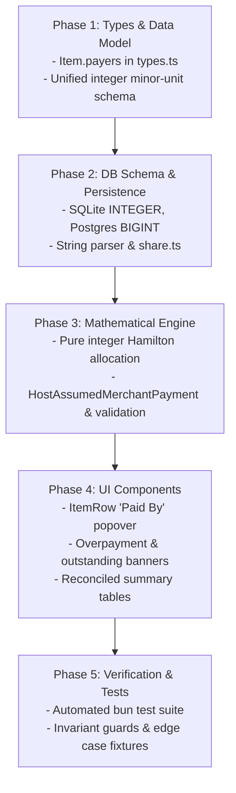

# Architecture & Implementation Plan: Multi-Payer Support (Bill-Level & Item-Level)

> **Document Type**: Technical Specification & Implementation Plan  
> **Status**: Draft for User Review (Planning Mode)  
> **Target Version**: Ledger 2.1  
> **Author**: Antigravity Assistant  
> **Date**: October 2026  

---

## 1. Executive Summary & Problem Statement

Currently, **Ledger** operates primarily on a **Single Primary Payer (Host)** model:
- The `hostId` represents the single individual who settles the receipt with the merchant or venue.
- While individual participants have a `paidAmount` field on the `Person` record, it only accounts for coarse, bill-level upfront transfers (e.g. cash deposits or bank transfers sent to the host).
- **Items have NO concept of who paid for them**. The `Item.assignments` record solely captures *who consumed* (or shared) the item.
- The settlement engine uses a strict **Hub-and-Spoke** topology where all non-host participants either send money to the Host (if debtors) or receive reimbursement from the Host (if creditors).

### The Real-World Need
In modern group activities (team dinners, road trips, group vacations, sports matches, shared rentals), expenses are rarely paid by a single person:
1. **Item-Level Payers**:
   - Alice pays for the expensive bottle of wine ($80).
   - Bob and Charlie split paying for the shared Seafood Platter ($120) 50/50, but 6 people at the table ate it.
   - David grabs the taxi receipt ($35) on the way to the restaurant.
2. **Multiple Payers on a Single Item**:
   - Two people contribute distinct amounts towards a single expensive item or deposit (e.g., Alice puts down $50 and Bob puts down $70 for a $120 activity ticket).
3. **Decoupled Settlement**:
   - When multiple people have paid for various items, multiple creditors emerge simultaneously. A rigid hub-and-spoke model forced through one "Host" creates unnecessary intermediary transactions.

---

## 2. Core Domain Model & Definitions

```
                     ┌───────────────────────────────────┐
                     │               ITEM                │
                     │  - price: 100,000                 │
                     │  - quantity: 1                    │
                     └─────────────────┬─────────────────┘
                                       │
            ┌──────────────────────────┴──────────────────────────┐
            ▼                                                     ▼
┌───────────────────────┐                             ┌───────────────────────┐
│     WHO PAID IT?      │                             │    WHO CONSUMED IT?   │
│     (Payers Map)      │                             │   (Assignments Map)   │
├───────────────────────┤                             ├───────────────────────┤
│ Bob:     60,000 (60%) │                             │ Bob:     1 share      │
│ Charlie: 40,000 (40%) │                             │ David:   1 share      │
│                       │                             │ Eve:     1 share      │
└───────────┬───────────┘                             └───────────┬───────────┘
            │ Credited                                            │ Debited
            ▼                                                     ▼
┌───────────────────────┐                             ┌───────────────────────┐
│  TOTAL PAID BY PERSON │                             │  TOTAL OWED BY PERSON │
└───────────┬───────────┘                             └───────────┬───────────┘
            │                                                     │
            └──────────────────────────┬──────────────────────────┘
                                       ▼
                       ┌───────────────────────────────┐
                       │          NET BALANCE          │
                       │    Balance = Paid - Owed      │
                       │  +ve: Creditor (Reimbursed)   │
                       │  -ve: Debtor   (Must Pay)     │
                       └───────────────┬───────────────┘
                                       ▼
                       ┌───────────────────────────────┐
                       │       SETTLEMENT ENGINE       │
                       │   Min-Cash-Flow / Hub-Spoke   │
                       └───────────────────────────────┘
```

### Definitions & Payment Accounting Taxonomy:

To ensure rigorous financial accounting, Ledger separates payments by source, destination, and liability:

1. **Consumers (`Item.assignments: Record<PersonId, Quantity>`)**:
   - Captures who consumed the item and in what quantity.
   - Generates the participant's **Consumption Liability** (what they owe for items).
2. **Item Payers (`Item.payers: Record<PersonId, Amount>`)**:
   - Captures payments disbursed **directly to the merchant/venue** for this specific item.
   - Generates the participant's **Item Payment Credit** (stored in integer minor units).
3. **Bill-Level Direct Merchant Payments (`Person.paidAmount`) — Migration Contract**:
   > [!IMPORTANT]
   > **Explicit Accounting Contract for `Person.paidAmount`**:
   > `Person.paidAmount` strictly represents **Direct Merchant Payments** made by that participant directly to the venue/merchant that are NOT tied to a specific item (e.g. an advance booking deposit paid to the restaurant, or cash handed to the waiter for the table).
   >
   > **Peer-to-Peer Advances vs Merchant Payments**:
   > If a participant (e.g. Bob) transfers money directly to the Host (e.g. Alice) before or during dinner via bank transfer, that is an **Inter-Participant Peer Transfer**, NOT a merchant payment. Peer transfers reduce Bob's debt to Alice and reduce Alice's credit from Bob; they do NOT increase merchant payments. Entering peer transfers into `paidAmount` would artificially inflate merchant credits. Peer transfers are handled as pre-settlement balance offsets.
4. **Assumed Merchant Coverage (`HostAssumedMerchantPayment`)**:
   - If a bill has an unpaid merchant balance, and Host Coverage Mode is enabled, the Host explicitly assumes the outstanding merchant balance at settlement time.

---

## 3. Data Architecture & Database Migrations

### 3.1 Store & Frontend Types (`src/store/useBillStore.ts`, `db/types.ts`)

```typescript
// db/types.ts & src/store/useBillStore.ts

export interface Item {
  id: string;
  name: string;
  price: number; // Total line item price in current currency
  quantity: number; // Portion/unit count (>= 1)
  assignments: Record<string, number>; // personId -> quantity consumed
  payers?: Record<string, number>;      // personId -> amount paid to merchant in current currency
}

export interface ItemData {
  id: string;
  name: string;
  price: number;
  quantity?: number;
  assignments?: Record<string, number>;
  payers?: Record<string, number>;
}
```

### 3.2 Relational Database Schema (`db/sqlite.ts` & `db/postgres.ts`)

To store item-level payer distributions in SQLite and PostgreSQL without floating-point precision loss:

> [!IMPORTANT]
> **Unified Minor-Unit Integer Storage Standard**:
> Using floating-point types (`REAL`, `DOUBLE PRECISION`) causes IEEE 754 precision drift, leading to orphaned cents, dropped transfers, or unbalanced ledgers.
> To ensure 100% cross-database parity and eliminate precision loss, **BOTH SQLite and PostgreSQL store all monetary amounts as integer atomic minor units (e.g., cents for USD/EUR, integer dong for VND)**.
>
> | Currency | Real-World Amount | Stored Integer in DB |
> | :--- | :--- | :--- |
> | **USD** | `$10.50` | `1050` (cents) |
> | **EUR** | `€10.50` | `1050` (cents) |
> | **VND** | `10.5 ₫` (from split) | `11` (dong, auto half-up) |
> | **VND** | `100,000 ₫` | `100000` (dong) |
> | **JPY** | `1,500 ¥` | `1500` (yen) |

```sql
-- SQLite Table Definition (amounts stored in integer minor units / cents)
CREATE TABLE IF NOT EXISTS item_payers (
  item_id TEXT NOT NULL,
  person_id TEXT NOT NULL,
  amount INTEGER NOT NULL, -- Stored as integer minor units (e.g. cents)
  PRIMARY KEY (item_id, person_id),
  FOREIGN KEY(item_id) REFERENCES items(id) ON DELETE CASCADE,
  FOREIGN KEY(person_id) REFERENCES people(id) ON DELETE CASCADE
);

-- PostgreSQL Table Definition (amounts stored in BIGINT integer minor units / cents)
CREATE TABLE IF NOT EXISTS item_payers (
  item_id TEXT NOT NULL,
  person_id TEXT NOT NULL,
  amount BIGINT NOT NULL, -- Stored as integer minor units (e.g. cents)
  PRIMARY KEY (item_id, person_id),
  FOREIGN KEY(item_id) REFERENCES items(id) ON DELETE CASCADE,
  FOREIGN KEY(person_id) REFERENCES people(id) ON DELETE CASCADE
);
```

#### Safe Automatic Migration on Startup:
```typescript
// In db/sqlite.ts init()
this.db.exec(`
  CREATE TABLE IF NOT EXISTS item_payers (
    item_id TEXT NOT NULL,
    person_id TEXT NOT NULL,
    amount INTEGER NOT NULL,
    PRIMARY KEY (item_id, person_id),
    FOREIGN KEY(item_id) REFERENCES items(id) ON DELETE CASCADE,
    FOREIGN KEY(person_id) REFERENCES people(id) ON DELETE CASCADE
  );
`);

// In db/postgres.ts init()
await this.client.query(`
  CREATE TABLE IF NOT EXISTS item_payers (
    item_id TEXT NOT NULL,
    person_id TEXT NOT NULL,
    amount BIGINT NOT NULL,
    PRIMARY KEY (item_id, person_id),
    FOREIGN KEY(item_id) REFERENCES items(id) ON DELETE CASCADE,
    FOREIGN KEY(person_id) REFERENCES people(id) ON DELETE CASCADE
  );
`);
```
```

#### Read & Write Logic:
- **`getBill(id)`**:
  Query `item_payers` alongside `item_assignments`:
  ```sql
  SELECT person_id, amount FROM item_payers WHERE item_id = ?
  ```
  Map into `item.payers: Record<string, number>`.
- **`saveBill(id, data)`**:
  Inside the database transaction:
  ```sql
  DELETE FROM item_payers WHERE item_id = ?;
  INSERT INTO item_payers (item_id, person_id, amount) VALUES (?, ?, ?);
  ```

### 3.3 Share URL State Serialization (`src/lib/share.ts`)

To maintain compact URL sharing while supporting item payers:
```typescript
// serializeState:
// i: [id, name, price, quantity, assignments, payers]
i: state.items.map((i: any) => [
  i.id,
  i.name,
  i.price,
  i.quantity,
  i.assignments,
  i.payers || {}
])

// deserializeState:
items: data.i.map((i: any) => ({
  id: i[0],
  name: i[1],
  price: i[2],
  quantity: i[3],
  assignments: i[4],
  payers: i[5] || {} // backwards-compatible if index 5 is missing
}))
```

---

## 4. Mathematical Engine, Settlement Algorithms & Invariant Proofs

### 4.1 Consumption Liabilities & Assignment Rules (Addressing P1: Unassigned Consumption & Quantities)

The calculation of how much each participant **owes** is strictly grounded in actual consumption, with explicit mathematical rules governing item quantities, shares, and unassigned portions.

#### 1. Item Semantic Definition
- For each item $i$, $P_i$ denotes the **total line price** in integer minor units (e.g. cents or dong), and $Q_i \ge 1$ denotes the item **quantity** (units/portions).
- In the user interface, the per-unit price is displayed as $P_i / Q_i$, but line total liability is always anchored to $P_i$.
- Each participant $p$ can be assigned a claimed quantity $q_{i, p} \ge 0$.
- The total claimed quantity across all participants for item $i$ is:
  ```
  ClaimedQty(i) = Sum of q(i, p) across all participants p
  ```

#### 2. Exact Consumption Share Calculation
Depending on the relationship between `ClaimedQty(i)` and `Q_i`, four precise regimes exist:

- **Case A: Fully Claimed (`ClaimedQty(i) == Q_i`)**:
  Each assigned participant pays exactly for their consumed units:
  ```
  Share(p, i) = (q(i, p) / Q_i) * P_i
  UnassignedCost(i) = 0
  ```

- **Case B: Oversubscribed (`ClaimedQty(i) > Q_i`)**:
  Participants claimed more units than physically present on the line (e.g., 3 people claimed 1 whole pizza each on a 2-pizza line).
  - **Primary Behavior (Validation Guard)**: The system displays an **Oversubscription Warning** and prompts participants to correct the claimed portions or increase line item quantity.
  - **Recovery Mode (Pro-rata Scaling)**: If the group explicitly confirms sharing the available units, cost scales proportionally:
    ```
    Share(p, i) = (q(i, p) / ClaimedQty(i)) * P_i
    UnassignedCost(i) = 0
    ```

- **Case C: Undersubscribed / Partially Assigned (`0 < ClaimedQty(i) < Q_i`)**:
  Participants claimed only a fraction of the available quantity (e.g. 1 out of 3 appetizers claimed).
  Each assigned participant pays their exact unit cost:
  ```
  Share(p, i) = (q(i, p) / Q_i) * P_i
  AccountedCost(i) = Sum of Share(p, i) across assigned participants
  UnassignedCost(i) = P_i - AccountedCost(i)
  ```

- **Case D: Completely Unassigned (`ClaimedQty(i) == 0`)**:
  No participant has claimed this item line:
  ```
  Share(p, i) = 0 for all p
  UnassignedCost(i) = P_i
  ```

#### 3. Eligible Cohort & Host Absorption for Unassigned Consumption
To eliminate ambiguity over who absorbs unassigned items and leftover portions, Ledger establishes a defined **Eligible Splitter Cohort** ($E$):

- **Rule 1: Bill-Wide Table Pool (Default)**:
  ```
  EligibleCohort E = All participants on the bill (people.map(p => p.id))
  ```
  Every participant on the bill shares equally in unassigned food and communal items. Leftover indivisible cents are allocated using the Hamilton method.

- **Rule 2: Active Consumers Cohort (Configurable)**:
  ```
  EligibleCohort E = { p in people | p has at least 1 item assigned on the bill }
  Fallback: If E is empty, E = All participants on the bill
  ```
  Only participants who actively ordered/consumed items split unassigned shared dishes; inactive members (e.g. late arrivals who had nothing) are not charged.

- **Rule 3: Host Absorption (Explicit Accounting)**:
  If a Host is designated and "Host covers unassigned items" is enabled:
  ```
  RawCost(host) += UnassignedCost(i)
  ```
  The unassigned liability is **explicitly added to the Host's liabilities** (and not charged to the cohort). This preserves total liability conservation: `Sum of RawCost(p) == Sum of P_i`.

#### 4. Raw Cost Aggregation
Each participant's total raw base consumption is:
```
RawCost(p) = (Sum of Share(p, i) across all items i)
           + (UnassignedCost(i) / |E| for each i where p in E, if not host-absorbed)
           + (UnassignedCost(i) if p == hostId and host-absorbed else 0)
```
> **Conservation Invariant**: `Sum of RawCost(p) across all p == Sum of P_i across all items i` strictly holds.

---

### 4.2 Proportional Extras & Final Liabilities (Sponsor Feature Completely Removed)

> [!NOTE]
> **Sponsor Feature Removal**:
> Per user specification, the **Sponsorship** feature (sponsor amounts, sponsor subsidies, and discount ratio adjustments) has been **completely removed**.
> Liabilities are calculated directly and transparently from consumed items plus proportional taxes and fees.

#### Global Charges & Adjustments Sign Convention:
- **Positive Charges (`PositiveExtras`)**: Taxes, service charges, venue fees, and gratuity/tips ($\ge 0$).
- **Discounts (`Discounts`)**: Bill-wide coupons, merchant vouchers, or promotional discounts ($\ge 0$).
- **Net Extras (`NetExtras`)**:
  ```
  NetExtras = PositiveExtras - Discounts
  TotalBill = TotalItemCosts + NetExtras
  ```

#### Proportional Allocation of Net Extras:
Net extras are allocated strictly in proportion to each participant's base raw consumption:
```
TotalRawCosts = Sum of RawCost(p) across all participants

If TotalRawCosts > 0:
  ExtrasShare(p) = NetExtras * (RawCost(p) / TotalRawCosts)
Else (e.g., drinks-only or communal bill before items assigned):
  ExtrasShare(p) = NetExtras / |E| (split equally among eligible cohort E)
```

#### Total Final Liability:
Because there is no sponsorship or discount subsidy, each participant's liability is purely:
```
FinalPayable(p) = RawCost(p) + ExtrasShare(p)
```
> **Total Liabilities Invariant**:
> `Sum of FinalPayable(p) across all p == TotalBill` (where `TotalBill = TotalItemCosts + NetExtras`).

---

### 4.3 Merchant Payment Accounting, Host Assumed Coverage & Overpayment Reconciliation

Ledger maintains a rigorous distinction between **Merchant Settlement** (satisfying the venue's bill) and **Internal Group Settlement** (reconciling debts between participants).

#### 1. Actual Recorded Merchant Payments
A participant's recorded merchant payments consist of:
1. `ItemPaid(p)`: Sum of explicit item-level payer amounts (`item.payers[p]`).
2. `DirectMerchantPaid(p)`: Legitimate bill-level merchant payments (`Person.paidAmount`, e.g. advance venue deposit or cash paid at the counter).

```
ActualMerchantPaid(p) = ItemPaid(p) + DirectMerchantPaid(p)
TotalMerchantPaid     = Sum of ActualMerchantPaid(p) across all participants
```

#### 2. Item-Level Overpayment Reconciliation
For each item $i$, let $A_i = \sum_p \text{item.payers}_i[p]$:
- If $A_i > P_i$: **Overpayment Validation Error**.
  Settlement is **BLOCKED** until the user resolves the excess $(A_i - P_i)$:
  - **Option A (Correction)**: Fix the mistaken payer entry.
  - **Option B (Convert to Tip)**: Categorize excess as a server tip, which adds to `PositiveExtras` and increases `TotalBill` to match payments.
  - **Option C (Refund)**: Mark the excess as a refunded overpayment.
  > Under no circumstances does the engine silently inflate unsupported payment credits into group debt.

#### 3. Bill-Level Outstanding Merchant Balance & Host Assumed Coverage
Comparing recorded payments to the merchant against the total bill:
```
OutstandingMerchantDue = max(0, TotalBill - TotalMerchantPaid)
```

- **When Host Coverage Mode is Enabled (`hostId` is designated and active)**:
  The Host explicitly assumes responsibility for satisfying the remaining merchant receipt:
  ```
  HostAssumedMerchantPayment = OutstandingMerchantDue
  EffectivePaid(host)        = ActualMerchantPaid(host) + HostAssumedMerchantPayment
  EffectivePaid(p)           = ActualMerchantPaid(p)  (for p != hostId)
  ```
  This guarantees that total effective merchant payments match the bill total:
  ```
  Sum of EffectivePaid(p) = TotalMerchantPaid + (TotalBill - TotalMerchantPaid) == TotalBill
  ```

- **When No Host Coverage Mode (or No Host Designated)**:
  If `OutstandingMerchantDue > 0`:
  - The unpaid amount is an **Unsettled Merchant Liability**, NOT a peer debt between participants.
  - The system displays a prominent banner: `Outstanding Merchant Balance: X ₫. Bill is not fully paid.`
  - Peer-to-peer settlement is **BLOCKED** until all merchant costs are allocated.

- **When Total Payments Exceed Total Bill (`TotalMerchantPaid > TotalBill`)**:
  - The excess is flagged as an `Overpayment Discrepancy`.
  - Settlement is blocked until the excess is allocated to a Tip or adjusted.

---

### 4.4 Fixed-Point / Integer Arithmetic, Decimal-Only Rounding & Deterministic Hamilton Method

> [!IMPORTANT]
> **Zero Precision Drift via Integer Cent Arithmetic**:
> Standard IEEE 754 floating-point operations (`0.1 + 0.2 = 0.30000000000000004`) and naive float thresholds (`Math.abs(b) <= 0.01`) drop cents and leave unbalanced residuals.
> All internal calculations, allocations, and balances MUST operate in **integer atomic units** (cents for USD/EUR, integer dong for VND).

#### Decimal-Only Auto-Rounding Rule:
> **Core Policy**: Auto round up or down (half-up) **ONLY for decimal fractions**.
> - **0-Decimal Currencies (VND, JPY, KRW)**:
>   - Any decimal resulting from divisions/multiplications is rounded to the nearest integer dong: e.g. **`6.666 ₫` automatically rounds to `7 ₫`**; `6.4 ₫` rounds to `6 ₫`.
>   - **DO NOT round whole digits**: whole amounts are NEVER rounded to nearest 1,000 ₫, 500 ₫, or 100 ₫. An amount of `12,345 ₫` remains strictly `12,345 ₫`.
> - **2-Decimal Currencies (USD, EUR, SGD, GBP)**:
>   - Decimal fractions beyond 2 decimal places are rounded to the nearest cent: e.g. `$6.666` automatically rounds to `$6.67`; `$6.664` rounds to `$6.66`.

#### Exact String-to-Minor-Units Parser (Avoiding Float Math):
```typescript
function parseToMinorUnits(input: string, decimals: number = 0): number {
  const cleaned = input.trim().replace(/,/g, '');
  if (!cleaned) return 0;

  const parts = cleaned.split('.');
  const wholePart = BigInt(parts[0] || '0');

  if (decimals === 0) {
    if (parts.length > 1) {
      // Half-up rounding on first decimal digit
      const firstDecimal = parseInt(parts[1][0] || '0', 10);
      return Number(wholePart + (firstDecimal >= 5 ? 1n : 0n));
    }
    return Number(wholePart);
  }

  // For 2-decimal currencies (e.g. USD)
  const fracString = (parts[1] || '').padEnd(decimals + 1, '0');
  const baseFrac = BigInt(fracString.slice(0, decimals));
  const roundDigit = parseInt(fracString[decimals] || '0', 10);
  const totalMinor = wholePart * BigInt(10 ** decimals) + baseFrac + (roundDigit >= 5 ? 1n : 0n);

  return Number(totalMinor);
}
```

#### Pure Integer Hamilton Method (Deterministic Remainder Distribution):
To distribute an indivisible integer amount (e.g. 20 ₫ among 3 people, or taxes across fractional shares) without floating-point quotient or remainder:
```typescript
interface ParticipantWeight {
  participantId: string;
  weight: number; // Integer minor units (e.g. raw cost in cents)
}

function distributeIntegerMinorUnits(
  totalMinorUnits: number,
  participants: ParticipantWeight[]
): Record<string, number> {
  if (totalMinorUnits === 0 || participants.length === 0) {
    return Object.fromEntries(participants.map(p => [p.participantId, 0]));
  }

  const total = BigInt(totalMinorUnits);
  const sumWeights = participants.reduce((sum, p) => sum + BigInt(p.weight), 0n);

  if (sumWeights === 0n) {
    // Equal distribution among participants
    const n = BigInt(participants.length);
    const base = Number(total / n);
    const rem = Number(total % n);
    // Sort deterministically by participantId
    const sorted = [...participants].sort((a, b) => a.participantId.localeCompare(b.participantId));
    const result: Record<string, number> = {};
    sorted.forEach((p, idx) => {
      result[p.participantId] = base + (idx < rem ? 1 : 0);
    });
    return result;
  }

  // Step 1: Pure integer quotient and remainder via BigInt
  const shares: Array<{ id: string; base: number; remainder: bigint }> = [];
  let allocatedSum = 0;

  participants.forEach(p => {
    const w = BigInt(p.weight);
    const numerator = total * w;
    const base = Number(numerator / sumWeights);
    const remainder = numerator % sumWeights;

    shares.push({ id: p.participantId, base, remainder });
    allocatedSum += base;
  });

  // Step 2: Leftover indivisible units
  let leftover = totalMinorUnits - allocatedSum;

  // Step 3: Sort by remainder descending, breaking ties deterministically by participantId ascending
  shares.sort((a, b) => {
    if (b.remainder !== a.remainder) {
      return b.remainder > a.remainder ? 1 : -1;
    }
    return a.id.localeCompare(b.id);
  });

  // Step 4: Allocate 1 unit each to top remainders
  for (let i = 0; i < leftover; i++) {
    shares[i].base += 1;
  }

  // INVARIANT: Sum of all allocated bases === totalMinorUnits strictly
  return Object.fromEntries(shares.map(s => [s.id, s.base]));
}
```
**Outcome**:
- Guarantees `Sum of shares === totalMinorUnits` strictly to the exact single cent/dong.
- Pure integer math with **no floating-point intermediates**.
- Deterministic tie-breaking by `participantId` ensures cross-platform reproducibility.

---

### 4.5 Net Balances & The Zero-Sum Settlement Invariant

Operating on integer minor units, each participant's net balance is:
```
Balance(p) = EffectivePaid(p) - FinalPayable(p)
```

- `Balance(p) > 0`  -> **Creditor** (paid more than liability; receives money).
- `Balance(p) < 0`  -> **Debtor** (paid less than liability; must pay money).
- `Balance(p) == 0` -> **Settled** (balance is exactly zero).

#### Formal Domain Proof of Zero-Sum Conservation:
The zero-sum invariant does not rely on fabricating payments; it is the natural mathematical result of two domain conditions being satisfied:

1. **Domain Condition 1 (Bill is Fully Settled to Merchant)**:
   Under Host coverage or full allocation, total effective merchant payments equal the bill:
   $$\sum_{p} \text{EffectivePaid}(p) \equiv \text{TotalBill}$$

2. **Domain Condition 2 (All Liabilities Are Fully Reconciled)**:
   By construction of item shares and proportional net extras:
   $$\sum_{p} \text{FinalPayable}(p) \equiv \text{TotalBill}$$

3. **Algebraic Invariant**:
   $$\sum_{p} \text{Balance}(p) = \sum_{p} \text{EffectivePaid}(p) - \sum_{p} \text{FinalPayable}(p) = \text{TotalBill} - \text{TotalBill} \equiv 0$$

> **Conclusion**: The ledger is zero-sum strictly because every cent of merchant liability is funded, and every cent of participant liability is accounted for.

---

### 4.6 Settlement Algorithm: Precondition Guards & Topology

#### 1. Input Reconciliation Guard (`validateBalances`)
Before executing any settlement transfers, the engine verifies that the ledger is balanced and integer-safe:

```typescript
function validateBalances(balances: Record<string, number>): void {
  const entries = Object.entries(balances);

  for (const [id, val] of entries) {
    if (!Number.isSafeInteger(val)) {
      throw new Error(`Balance for participant ${id} is not a safe integer: ${val}`);
    }
  }

  const sumBalances = entries.reduce((sum, [_, val]) => sum + BigInt(val), 0n);
  if (sumBalances !== 0n) {
    throw new Error(`Ledger balances do not reconcile to zero! Residual sum: ${sumBalances}`);
  }
}
```

#### 2. Direct Settlement Transfers: Greedy Minimization ($N - 1$ Upper Bound)
The greedy algorithm repeatedly matches the largest debtor with the largest creditor. It is guaranteed to settle any balanced group of $N$ participants in **at most $N - 1$ transactions**.

```typescript
interface TransferFlow {
  from: string;
  to: string;
  amount: number; // in integer minor units / cents
}

function computeGreedyTransfers(balances: Record<string, number>): TransferFlow[] {
  // Precondition check: must reconcile to 0
  validateBalances(balances);

  const debtors = Object.entries(balances)
    .filter(([_, b]) => b < 0)
    .map(([id, b]) => ({ id, amount: Math.abs(b) }))
    .sort((a, b) => b.amount - a.amount || a.id.localeCompare(b.id));

  const creditors = Object.entries(balances)
    .filter(([_, b]) => b > 0)
    .map(([id, b]) => ({ id, amount: b }))
    .sort((a, b) => b.amount - a.amount || a.id.localeCompare(b.id));

  const flows: TransferFlow[] = [];
  let d = 0;
  let c = 0;

  while (d < debtors.length && c < creditors.length) {
    const debtor = debtors[d];
    const creditor = creditors[c];
    const settledAmount = Math.min(debtor.amount, creditor.amount);

    if (settledAmount > 0) {
      flows.push({ from: debtor.id, to: creditor.id, amount: settledAmount });
    }

    debtor.amount -= settledAmount;
    creditor.amount -= settledAmount;

    if (debtor.amount === 0) d++;
    if (creditor.amount === 0) c++;
  }

  // Post-condition validation: all debtors and creditors must be exactly 0
  if (d < debtors.length || c < creditors.length) {
    throw new Error("Settlement algorithm terminated with unsettled residuals");
  }

  return flows;
}
```

#### Algorithmic Complexity Clarification:
- Finding the absolute theoretical minimum number of transactions across $N$ parties is **NP-hard** (reducible to Subset Sum / Partition).
- The greedy algorithm achieves an optimal upper bound of $N - 1$ transfers in $O(N \log N)$ time.
- For small groups ($N \le 12$), an optional Dynamic Programming Subset-Sum Partition solver can identify independent zero-sum subgroups to achieve the absolute global minimum ($N - K$ transfers, where $K$ is the number of disjoint zero-sum subsets).

#### Alternative Mode: Host-Centered Hub & Spoke
- Every debtor ($p \ne \text{host}$ where $\text{Balance}(p) < 0$) transfers $|\text{Balance}(p)|$ to Host.
- Host transfers $\text{Balance}(p)$ to each creditor ($p \ne \text{host}$ where $\text{Balance}(p) > 0$).

---

## 5. UI / UX Design & Component Architecture

### 5.1 Item Row: Dedicated "Paid By" Controls (`src/components/items/item-row.tsx`)

In the item card, next to the existing **"Assign Shares / Splits"** button, introduce a **"Paid By"** button:

```
┌────────────────────────────────────────────────────────────────────────┐
│  Wagyu Ribeye Steak                         ×1   350,000 ₫            │
│  350,000 ₫ PER UNIT  ·  3 members sharing                              │
│                                                                        │
│  [ 👥 3 Splits ]   [ 💳 Paid by: Alex (200k), Bob (150k) ]   [ ⋯ ]    │
└────────────────────────────────────────────────────────────────────────┘
```

#### Inside the "Paid By" Popover:
1. **Quick Single-Payer Selector**:
   - List of all participants. Clicking a participant instantly sets them as 100% payer for this item.
2. **"Split Payment" Mode**:
   - Allows selecting multiple payers for this single item.
   - Presets:
     - **Split Equally**: Automatically divides the item price equally among selected payers.
     - **Custom Amounts**: CurrencyInput fields for each selected payer.
   - **Real-Time Validation Bar**:
     - `Item Total: 350,000 ₫`
     - `Total Paid: 350,000 ₫ · ✓ Fully allocated`
     - Or: `Remaining: 150,000 ₫ · Covered by Host`

### 5.2 Bill Configuration: Payment Overview (`src/components/summary/bill-configuration.tsx`)

- Retain the **"Default Bill Payer (Host)"** selector for general bill settlement and unallocated items.
- Provide a clear **"Payment Breakdown"** table:
  - Participant name
  - Items Paid amount
  - Upfront / Direct amount
  - Total Contribution

### 5.3 Summary Section: Net Balances & Multi-Creditor Settlement (`src/components/summary/summary-section.tsx`)

#### Fully Reconciled Example Fixture (350,000 ₫ Bill, 3 Participants):
- **Bill Breakdown**: Items total: 320,000 ₫ | Proportional Extras (Taxes/Tip): 30,000 ₫ | Total Bill: 350,000 ₫.
- **Consumption Subtotals**:
  - Alex (Host): 120,000 ₫ raw cost + 11,250 ₫ extras = **131,250 ₫ liability**.
  - Bob: 120,000 ₫ raw cost + 11,250 ₫ extras = **131,250 ₫ liability**.
  - Charlie: 80,000 ₫ raw cost + 7,500 ₫ extras = **87,500 ₫ liability**.
  - *Total Group Liabilities*: $131,250 + 131,250 + 87,500 = 350,000 ₫$.
- **Merchant Payments**:
  - Alex (Host) paid Steak: 200,000 ₫ to merchant.
  - Bob paid Seafood Platter: 150,000 ₫ to merchant.
  - Charlie paid: 0 ₫.
  - *Total Merchant Payments*: $200,000 + 150,000 + 0 = 350,000 ₫$ (Fully paid, 0 unpaid merchant balance).

#### Table Representation:
| Participant | Subtotal | Extras (Tax/Tip) | Merchant Paid | Net Balance | Status |
| :--- | :--- | :--- | :--- | :--- | :--- |
| **Alex (Host)** | 120,000 ₫ | 11,250 ₫ | 200,000 ₫ | **+68,750 ₫** | Creditor (Receives) |
| **Bob** | 120,000 ₫ | 11,250 ₫ | 150,000 ₫ | **+18,750 ₫** | Creditor (Receives) |
| **Charlie** | 80,000 ₫ | 7,500 ₫ | 0 ₫ | **-87,500 ₫** | Debtor (Pays) |
| **Total** | **320,000 ₫** | **30,000 ₫** | **350,000 ₫** | **0 ₫** | **Strict Zero-Sum Conservation** |

#### Direct Settlement Transfers:
- **Charlie pays Alex 68,750 ₫**
- **Charlie pays Bob 18,750 ₫**
> Total transfers: 2 (guaranteed $\le N-1$). All participant balances reach exactly 0 ₫.

---

## 6. Edge Cases, Currency Conversion & Safety Constraints

| Scenario | Behavior |
| :--- | :--- |
| **No item payers specified** | If Host mode is enabled, unallocated merchant payment falls to `HostAssumedMerchantPayment`. If no host, outstanding merchant balance blocks group settlement. |
| **Item partially paid (underpaid)** | If `hostId` exists, Host assumes remaining merchant balance via `HostAssumedMerchantPayment`. If no host, system displays `Outstanding Merchant Liability` banner. |
| **Item overpaid (sum of payers > price)** | **Validation Error**: Blocks settlement. User must adjust entries, allocate excess to `PositiveExtras` (Merchant Tip), or record as refunded deposit. |
| **Unassigned item portions** | If Host absorbs, added directly to `RawCost(host)`. Otherwise, split equally among defined Eligible Splitter Cohort $E$ using deterministic Hamilton method. |
| **Indivisible minor units** | Distribute leftover 1-cent residuals using pure integer Hamilton method with deterministic tie-breaking by `participantId` ascending. |
| **Pre-payments between participants** | Inter-participant advances (e.g. Venmo to host) must NOT be recorded as merchant `paidAmount`. They are applied as pre-settlement balance offsets. |
| **Currency conversion policy** | When converting bill currency (e.g., VND ↔ USD), convert minor units via fixed exchange rate snapshot $R$: `toMinor = Math.round(fromMinor * R * 10^(toDec - fromDec))`. Preserves integer atomic units with zero decimal drift. |
| **Participant removed from bill** | Purge participant from `item.payers`, `item.assignments`, and verify balance reconciliation before saving. |

---

## 7. Phased Implementation Roadmap



### Phase 1: Data Types & Store Actions
- Modify `db/types.ts` and `src/store/useBillStore.ts` to include `Item.payers?: Record<string, number>`.
- Remove `sponsorAmount` from `Person` and `PersonData`.
- Clarify `Person.paidAmount` strictly represents direct merchant payments.

### Phase 2: Database Adapters & Sharing
- Create `item_payers` table: `INTEGER` in `db/sqlite.ts` and `BIGINT` in `db/postgres.ts` (both storing integer atomic minor units).
- Implement `parseToMinorUnits` string parser to prevent float representation inaccuracies.
- Update `getBill` and `saveBill` methods to fetch and persist item-level payers in minor units.
- Update `serializeState` and `deserializeState` in `src/lib/share.ts`.

### Phase 3: Calculation & Settlement Engine
- Update `useBillState.ts`:
  - Implement exact item consumption logic with oversubscription warning guards.
  - Implement unassigned consumption with explicit Host absorption (`RawCost(host) += U_i`) or table cohort distribution.
  - Implement pure integer `distributeIntegerMinorUnits` (Hamilton method) using `BigInt` with deterministic ID tie-breaking.
  - Implement `OutstandingMerchantDue` and `HostAssumedMerchantPayment`.
  - Block settlement on item overpayment ($A_i > P_i$) or unassigned merchant debt without host.
  - Implement `validateBalances` guard verifying safe integers and exact zero sum.
  - Implement `computeGreedyTransfers` with post-execution verification.

### Phase 4: Frontend UI Components
- Update `src/components/items/item-row.tsx`:
  - Create the "Paid By" trigger and popover with single-payer and multi-payer split modes.
  - Real-time overpayment warning badge and oversubscription alert.
- Update `src/components/summary/bill-configuration.tsx` to display consolidated merchant payments.
- Update `src/components/summary/summary-section.tsx`:
  - Display reconciled table: `Subtotal | Extras | Merchant Paid | Net Balance`.
  - Direct settlement transfer cards with copyable payment instructions.

### Phase 5: Verification & Automated Tests
- Write automated tests in `tests/multi-payer.test.ts` covering:
  - **Single & multi-item multiple payers**: Reconciled test fixture matching Section 5.3 (350k bill, Alex 200k, Bob 150k -> Charlie pays Alex 68.75k, Charlie pays Bob 18.75k).
  - **Host coverage with explicit direct merchant payments**: Verifies that direct payments are not double-counted and invariant holds.
  - **Item overpayment guard**: Verifies settlement is blocked when $A_i > P_i$.
  - **Unpaid merchant balance guard**: Verifies settlement is blocked when no host is designated and bill is partially paid.
  - **Balance reconciliation guard (`validateBalances`)**: Verifies error is thrown if sum of balances is non-zero.
  - **Decimal-only auto-rounding**: 20 ₫ split among 3 people auto-rounds 6.666... ₫ up to 7 ₫ (distributing 7 ₫, 7 ₫, 6 ₫ to total exactly 20 ₫).
  - **Pure integer Hamilton conservation**: $10.00 split among 3 people equals exactly $3.34 + $3.33 + $3.33, with deterministic tie-breaking by participant ID.
  - **Currency conversion**: Switching USD ↔ VND correctly converts integer atomic units with zero decimal drift.

---

## 8. User Review & Feedback Points

> [!IMPORTANT]
> **Key Design Decisions for User Alignment**:
> 1. **Default Payer Preference**: When an item has no explicit payer, should it default to the **Primary Host** (current behavior) or remain **Unassigned** until explicitly chosen? *(Recommended: Default to Host for smooth, effortless entry).*
> 2. **Settlement Flow Style**: For groups with multiple payers, do you prefer **Direct Transfers (Greedy Minimization)** (minimizes transactions across everyone in $O(N \log N)$, at most $N-1$ transfers) or a **Host-as-Clearinghouse** mode (all money flows strictly through the host)? *(Recommended: Default to Direct Transfers with an optional Host-Clearinghouse toggle).*
> 3. **Item Overpayment Handling**: If an item price is $100 and payers enter $120 total, should the app **Block settlement until corrected** or offer an **Add $20 as Tip** quick action? *(Recommended: Offer one-click "Add as Server Tip" button).*
