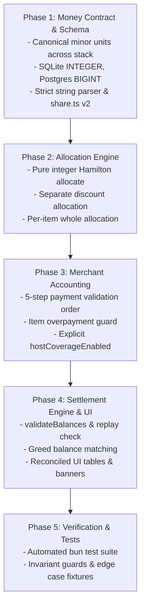

# Architecture & Implementation Plan: Multi-Payer Support (Bill-Level & Item-Level)

> **Document Type**: Technical Specification & Implementation Plan  
> **Status**: Implementation-Ready Final Specification (Planning Mode)  
> **Target Version**: Ledger 2.1  
> **Author**: Antigravity Assistant  
> **Date**: October 2026  

---

## 1. Executive Summary & Problem Statement

Currently, **Ledger** operates primarily on a **Single Primary Payer (Host)** model:
- The `hostId` represents the single individual who settles the receipt with the merchant or venue.
- While individual participants have a `paidAmount` field on the `Person` record, it only accounts for coarse, bill-level upfront transfers (e.g. cash deposits or bank transfers sent to the host).
- **Items have NO concept of who paid for them**. The `Item.assignments` record solely captures *who consumed* (or shared) the item.
- The settlement engine uses a strict **Hub-and-Spoke** topology where all non-host participants either send money to the Host (if debtors) or receive reimbursement from the Host (if creditors).

### The Real-World Need
In modern group activities (team dinners, road trips, group vacations, sports matches, shared rentals), expenses are rarely paid by a single person:
1. **Item-Level Payers**:
   - Alice pays for the expensive bottle of wine ($80).
   - Bob and Charlie split paying for the shared Seafood Platter ($120) 50/50, but 6 people at the table ate it.
   - David grabs the taxi receipt ($35) on the way to the restaurant.
2. **Multiple Payers on a Single Item**:
   - Two people contribute distinct amounts towards a single expensive item or deposit (e.g., Alice puts down $50 and Bob puts down $70 for a $120 activity ticket).
3. **Decoupled Settlement**:
   - When multiple people have paid for various items, multiple creditors emerge simultaneously. A rigid hub-and-spoke model forced through one "Host" creates unnecessary intermediary transactions.

---

## 2. Core Domain Model & Definitions

```
                     ┌───────────────────────────────────┐
                     │               ITEM                │
                     │  - price: 100,000                 │
                     │  - quantity: 1                    │
                     └─────────────────┬─────────────────┘
                                       │
            ┌──────────────────────────┴──────────────────────────┐
            ▼                                                     ▼
┌───────────────────────┐                             ┌───────────────────────┐
│     WHO PAID IT?      │                             │    WHO CONSUMED IT?   │
│     (Payers Map)      │                             │   (Assignments Map)   │
├───────────────────────┤                             ├───────────────────────┤
│ Bob:     60,000 (60%) │                             │ Bob:     1 share      │
│ Charlie: 40,000 (40%) │                             │ David:   1 share      │
│                       │                             │ Eve:     1 share      │
└───────────┬───────────┘                             └───────────┬───────────┘
            │ Credited                                            │ Debited
            ▼                                                     ▼
┌───────────────────────┐                             ┌───────────────────────┐
│  TOTAL PAID BY PERSON │                             │  TOTAL OWED BY PERSON │
└───────────┬───────────┘                             └───────────┬───────────┘
            │                                                     │
            └──────────────────────────┬──────────────────────────┘
                                       ▼
                       ┌───────────────────────────────┐
                       │          NET BALANCE          │
                       │    Balance = Paid - Owed      │
                       │  +ve: Creditor (Reimbursed)   │
                       │  -ve: Debtor   (Must Pay)     │
                       └───────────────┬───────────────┘
                                       ▼
                       ┌───────────────────────────────┐
                       │       SETTLEMENT ENGINE       │
                       │   Min-Cash-Flow / Hub-Spoke   │
                       └───────────────────────────────┘
```

### Definitions & Payment Accounting Taxonomy:

To ensure rigorous financial accounting, Ledger separates payments by source, destination, and liability:

1. **Consumers (`Item.assignments: Record<PersonId, Quantity>`)**:
   - Captures who consumed the item and in what quantity ($q_{i, p} \ge 0$).
   - Generates the participant's **Consumption Liability** (what they owe for items).
2. **Item Payers (`Item.payers: Record<PersonId, bigint>`)**:
   - Captures payments disbursed **directly to the merchant/venue** for this specific line item.
   - Generates the participant's **Item Payment Credit** (stored in canonical integer minor units as `bigint`).
3. **Bill-Level Direct Merchant Payments (`Person.paidAmount: bigint`) — Migration Contract**:
   > [!IMPORTANT]
   > **Explicit Accounting Contract for `Person.paidAmount`**:
   > `Person.paidAmount` strictly represents **Direct Merchant Payments** made by that participant directly to the venue/merchant that are NOT tied to a specific item (e.g. an advance booking deposit paid to the restaurant, or cash handed to the waiter for the table).
   >
   > **Peer-to-Peer Advances vs Merchant Payments**:
   > If a participant (e.g. Bob) transfers money directly to the Host (e.g. Alice) before or during dinner via bank transfer, that is an **Inter-Participant Peer Transfer**, NOT a merchant payment. Peer transfers reduce Bob's debt to Alice and reduce Alice's credit from Bob; they do NOT increase merchant payments. Entering peer transfers into `paidAmount` would artificially inflate merchant credits.
4. **Inter-Participant Peer Transfers (`bill.peerTransfers: PeerTransfer[]`)**:
   - Recorded pre-settlement advances between participants.
   - Applied as explicit balance offsets before generating final settlement transfers:
     ```
     InitialBalance(p) = EffectiveMerchantPaid(p) - FinalPayable(p)
     NetBalance(p)     = InitialBalance(p) + Sum(advances received) - Sum(advances sent)
     ```
   - Zero-sum invariant is strictly conserved because each advance adds $x$ to recipient and subtracts $x$ from sender ($+x - x \equiv 0$).
5. **Assumed Merchant Coverage (`bill.hostCoverageStatus`)**:
   - An explicit, persisted bill-level state: `'disabled' | 'confirmed' | 'waived'`.
   - When set to `'confirmed'` and a Host is designated, the Host explicitly confirms assuming any genuine unpaid merchant balance (`OutstandingMerchantDue`) at settlement time. It is recorded as an auditable commitment, distinguishable from verified merchant transactions.

---

## 3. Canonical Money Unit Contract & Data Architecture

### 3.1 The Canonical Money Unit Contract (`bigint`)
To prevent dangerous conversions between major units (e.g. `$10.50`) and minor units (e.g. `1050` cents), Ledger enforces a strict boundary contract across the entire stack:

- **Calculation & Domain Engine (`useBillState.ts`, algorithms, store)**:
  All monetary values (`price`, `paidAmount`, `payers`, `extras`, `discounts`, `balances`) are strictly **canonical integer minor units stored as `bigint`**.
- **JSON Serialization & Share URLs**:
  Because `JSON.stringify` throws a `TypeError` on `bigint`, all API payloads, store persistence (localStorage/IndexedDB), and share URL serialization serialize `bigint` values as **decimal strings** (e.g. `"350000"`, `"1050"`). A universal reviver parses them back to `bigint` upon deserialization.
- **Database Persistence**:
  - SQLite: `INTEGER NOT NULL` storing 64-bit integer minor units. Adapter returns `bigint`.
  - PostgreSQL: `BIGINT NOT NULL` storing 64-bit integer minor units. Adapter parses driver string returns via `BigInt(val)`.
- **User Interface Boundary**:
  Decimal strings entered by users are parsed to `bigint` minor units via `parseToMinorUnits(input, decimals)` upon input. Formatted strings displayed to users are generated via `formatCurrency(minorUnits, currency)` upon render.

### 3.2 Store & Frontend Types (`src/store/useBillStore.ts`, `db/types.ts`)

```typescript
// db/types.ts & src/store/useBillStore.ts

export interface PeerTransfer {
  id: string;
  fromPersonId: string;
  toPersonId: string;
  amount: bigint; // canonical integer minor units
  note?: string;
  date: string;
}

export interface Item {
  id: string;
  name: string;
  price: bigint; // Canonical total line price in integer minor units (e.g. 350000n dong or 1050n cents)
  quantity: number; // Integer unit/portion count (>= 1)
  assignments: Record<string, number>; // personId -> portion quantity consumed
  payers?: Record<string, bigint>;      // personId -> amount paid to merchant in integer minor units
}

export interface ItemData {
  id: string;
  name: string;
  price: bigint; // integer minor units
  quantity?: number;
  assignments?: Record<string, number>;
  payers?: Record<string, bigint>;
}

export interface Person {
  id: string;
  name: string;
  paidAmount: bigint; // Direct merchant payment in integer minor units
  userId?: string | null;
  email?: string | null;
}

export interface BillDetail {
  id: string;
  name: string;
  currency: string;
  hostId: string | null;
  hostCoverageStatus: 'disabled' | 'confirmed' | 'waived';
  taxInclusion: 'inclusive' | 'exclusive'; // Tax inclusive vs exclusive line pricing
  peerTransfers: PeerTransfer[];
  items: Item[];
  people: Person[];
}
```

### 3.3 Relational Database Schema (`db/sqlite.ts` & `db/postgres.ts`)

```sql
-- SQLite Table Definition (amounts stored in integer minor units / cents)
CREATE TABLE IF NOT EXISTS item_payers (
  item_id TEXT NOT NULL,
  person_id TEXT NOT NULL,
  amount INTEGER NOT NULL, -- Stored as integer minor units (e.g. cents / dong)
  PRIMARY KEY (item_id, person_id),
  FOREIGN KEY(item_id) REFERENCES items(id) ON DELETE CASCADE,
  FOREIGN KEY(person_id) REFERENCES people(id) ON DELETE CASCADE
);

CREATE TABLE IF NOT EXISTS peer_transfers (
  id TEXT PRIMARY KEY,
  bill_id TEXT NOT NULL,
  from_person_id TEXT NOT NULL,
  to_person_id TEXT NOT NULL,
  amount INTEGER NOT NULL, -- Stored as integer minor units
  note TEXT,
  created_at TEXT NOT NULL,
  FOREIGN KEY(bill_id) REFERENCES bills(id) ON DELETE CASCADE,
  FOREIGN KEY(from_person_id) REFERENCES people(id) ON DELETE CASCADE,
  FOREIGN KEY(to_person_id) REFERENCES people(id) ON DELETE CASCADE
);

-- PostgreSQL Table Definition (amounts stored in BIGINT integer minor units / cents)
CREATE TABLE IF NOT EXISTS item_payers (
  item_id TEXT NOT NULL,
  person_id TEXT NOT NULL,
  amount BIGINT NOT NULL, -- Stored as integer minor units (e.g. cents / dong)
  PRIMARY KEY (item_id, person_id),
  FOREIGN KEY(item_id) REFERENCES items(id) ON DELETE CASCADE,
  FOREIGN KEY(person_id) REFERENCES people(id) ON DELETE CASCADE
);

CREATE TABLE IF NOT EXISTS peer_transfers (
  id TEXT PRIMARY KEY,
  bill_id TEXT NOT NULL,
  from_person_id TEXT NOT NULL,
  to_person_id TEXT NOT NULL,
  amount BIGINT NOT NULL, -- Stored as integer minor units
  note TEXT,
  created_at TIMESTAMPTZ NOT NULL,
  FOREIGN KEY(bill_id) REFERENCES bills(id) ON DELETE CASCADE,
  FOREIGN KEY(from_person_id) REFERENCES people(id) ON DELETE CASCADE,
  FOREIGN KEY(to_person_id) REFERENCES people(id) ON DELETE CASCADE
);
```

#### Adapter Read & Write Logic (Driver Parity & Parameterization):
- **SQLite Adapter (`db/sqlite.ts`)**:
  - Uses `?` parameter placeholders.
  - Queries return `INTEGER` parsed to `BigInt(row.amount)`.
  ```typescript
  // getBill(id)
  const rows = this.db.prepare('SELECT person_id, amount FROM item_payers WHERE item_id = ?').all(itemId) as any[];
  const payers: Record<string, bigint> = {};
  for (const row of rows) {
    payers[row.person_id] = BigInt(row.amount);
  }

  // saveBill(id, data) inside atomic transaction
  const insertPayer = this.db.prepare('INSERT INTO item_payers (item_id, person_id, amount) VALUES (?, ?, ?)');
  for (const [personId, amount] of Object.entries(item.payers || {})) {
    insertPayer.run(item.id, personId, Number(amount)); // better-sqlite3 handles safe integers
  }
  ```
- **PostgreSQL Adapter (`db/postgres.ts`)**:
  - Uses `$1, $2, ...` positional parameter placeholders.
  - `pg` driver returns `BIGINT` as strings to prevent JS float overflow.
  ```typescript
  // getBill(id)
  const result = await this.client.query('SELECT person_id, amount FROM item_payers WHERE item_id = $1', [itemId]);
  const payers: Record<string, bigint> = {};
  for (const row of result.rows) {
    payers[row.person_id] = BigInt(row.amount);
  }

  // saveBill(id, data) inside atomic transaction
  for (const [personId, amount] of Object.entries(item.payers || {})) {
    await this.client.query('INSERT INTO item_payers (item_id, person_id, amount) VALUES ($1, $2, $3)', [item.id, personId, amount.toString()]);
  }
  ```

### 3.4 Share URL State Serialization (`src/lib/share.ts`)

To maintain compact URL sharing while guaranteeing canonical minor units and JSON compatibility:
```typescript
// serializeState (v2 format):
// v: 2 (version identifier)
// i: [id, name, priceStr, quantity, assignments, payersStr]
v: 2,
i: state.items.map((i: any) => [
  i.id,
  i.name,
  i.price.toString(),    // serialized as decimal string to avoid BigInt JSON error
  i.quantity,            // integer portion count
  i.assignments,
  Object.fromEntries(Object.entries(i.payers || {}).map(([pId, amt]) => [pId, amt.toString()]))
])

// deserializeState:
// If v === 2: read decimal strings directly via BigInt(str)
// If v is missing (legacy v1): execute legacy migration (Section 3.5)
```

### 3.5 Legacy Data Migration Specification
To upgrade existing bills from legacy floating-point major units (e.g. `$10.50` USD) to integer minor units (e.g. `1050n` cents) without data corruption:

1. **Database Schema Versioning**:
   Track migration status via `PRAGMA user_version = 2` (SQLite) and `schema_migrations` table (Postgres).
2. **Transactional Migration Procedure**:
   For every existing bill in the database:
   - Read the bill's ISO currency code (`bill.currency`).
   - Determine scale factor: $S = 10^{\text{decimals}}$ (e.g., $S = 100$ for USD/EUR, $S = 1$ for VND/JPY).
   - In SQLite:
     ```sql
     UPDATE items SET price = CAST(ROUND(price * ?) AS INTEGER) WHERE bill_id = ?;
     UPDATE people SET paid_amount = CAST(ROUND(paid_amount * ?) AS INTEGER) WHERE bill_id = ?;
     UPDATE global_charges SET amount = CAST(ROUND(amount * ?) AS INTEGER) WHERE bill_id = ? AND type = 'fixed';
     ```
   - In PostgreSQL:
     ```sql
     UPDATE items SET price = (ROUND(price * $1))::BIGINT WHERE bill_id = $2;
     UPDATE people SET paid_amount = (ROUND(paid_amount * $1))::BIGINT WHERE bill_id = $2;
     UPDATE global_charges SET amount = (ROUND(amount * $1))::BIGINT WHERE bill_id = $2 AND type = 'fixed';
     ```
3. **Legacy Share URL Upgrades**:
   When opening a legacy v1 share URL (where `v` is undefined):
   - Lookup currency decimals for the shared bill.
   - Multiply float prices and paid amounts by $10^{\text{decimals}}$ half-up, converting to `bigint`.
   - Resave as version 2 upon next modification.

---

## 4. Mathematical Engine, Settlement Algorithms & Invariant Proofs

### 4.1 Item Consumption Liabilities: Whole-Line Allocation & Quantity Rules

To prevent fractional minor-unit drift, consumption liabilities are calculated **per line item as a complete allocation** using exact integer shares, rather than independently rounding raw individual fractions.

#### 1. Item Semantic Definition
- For each item $i$, $P_i$ denotes the **total line price** in integer minor units (e.g. cents or dong), and $Q_i \ge 1$ is an integer denoting the item **quantity** (portions/units).
- In the user interface, the per-unit price is displayed as $P_i / Q_i$, but line total liability is always anchored to $P_i$.
- Each participant $p$ is assigned an integer portion quantity $q_{i, p} \ge 0$.
- The total claimed portions across all participants for item $i$ is:
  ```
  ClaimedQty(i) = Sum of q(i, p) across all participants p
  ```

#### 2. Exact Consumption Share Allocation (Per-Item Hamilton Method)
Depending on the relationship between `ClaimedQty(i)` and `Q_i`:

- **Case A: Fully Claimed (`ClaimedQty(i) == Q_i`)**:
  The full line total $P_i$ is distributed among assigned participants using the Hamilton integer method with weights $w_p = q_{i, p}$:
  ```
  Share(p, i) = HamiltonAllocate(P_i, { p: q(i, p) })[p]
  UnassignedCost(i) = 0
  ```
  > Strictly satisfies: `Sum of Share(p, i) == P_i`.

- **Case B: Oversubscribed (`ClaimedQty(i) > Q_i`)**:
  Participants claimed more units than physically present on the line (e.g., 3 people claimed 1 whole pizza each on a 2-pizza line).
  - **Primary Behavior (Validation Guard)**: The system displays an **Oversubscription Warning** and blocks settlement until participants correct the claimed portions or increase line item quantity.
  - **Recovery Mode (Pro-rata Scaling)**: If the group explicitly confirms sharing the available units, $P_i$ is distributed using the Hamilton integer method across claimants with weights $w_p = q_{i, p}$:
    ```
    Share(p, i) = HamiltonAllocate(P_i, { p: q(i, p) })[p]
    UnassignedCost(i) = 0
    ```

- **Case C: Undersubscribed / Partially Assigned (`0 < ClaimedQty(i) < Q_i`)**:
  Participants claimed only a fraction of the available quantity (e.g. 1 out of 3 appetizers claimed).
  To eliminate integer division flooring bias across assigned versus unassigned portions, the engine performs a **Joint Whole-Line Hamilton Allocation** of total line price $P_i$ across all portions, treating the unclaimed portions as a synthetic `__unassigned__` bucket:
  ```typescript
  // Weights: each claimant gets their portion weight q(i, p); unassigned remainder gets (Q_i - ClaimedQty(i))
  const jointWeights = [
    ...claimants.map(p => ({ participantId: p.id, weight: BigInt(q[i, p]) })),
    { participantId: '__unassigned__', weight: BigInt(Q_i - ClaimedQty(i)) }
  ];

  const jointAllocation = distributeIntegerMinorUnits(P_i, jointWeights);
  Share(p, i) = jointAllocation[p.id];
  UnassignedCost(i) = jointAllocation['__unassigned__'];
  ```
  > **Mathematical Guarantee**: Every portion (claimed or unassigned) receives an exact proportional base share $\lfloor P_i / Q_i \rfloor$ and an equitable, unbiased rank for leftover minor-unit remainders.
  > Strictly satisfies: `(Sum of Share(p, i) across claimants) + UnassignedCost(i) === P_i` down to the exact single minor unit.

- **Case D: Completely Unassigned (`ClaimedQty(i) == 0`)**:
  ```
  Share(p, i) = 0 for all p
  UnassignedCost(i) = P_i
  ```

#### 3. Eligible Cohort & Host Absorption for Unassigned Consumption
To eliminate ambiguity over who absorbs unassigned items and leftover portions, Ledger establishes a defined **Eligible Splitter Cohort** ($E$):

- **Rule 1: Bill-Wide Table Pool (Default)**:
  ```
  EligibleCohort E = All participants on the bill (people.map(p => p.id))
  ```
  Every participant on the bill shares equally in unassigned food and communal items. Leftover indivisible minor units are allocated using the Hamilton method.
  *Guard*: If $E$ is empty and $U_i > 0$, the engine throws an unallocated liability error.

- **Rule 2: Active Consumers Cohort (Configurable)**:
  ```
  EligibleCohort E = { p in people | p has at least 1 item assigned on the bill }
  Fallback: If E is empty, E = All participants on the bill
  ```
  Only participants who actively ordered/consumed items split unassigned shared dishes; inactive members (e.g. late arrivals who had nothing) are not charged.

- **Rule 3: Host Absorption (Explicit Accounting)**:
  If a Host is designated and "Host covers unassigned items" is enabled:
  ```
  RawCost(host) += UnassignedCost(i)
  ```
  The unassigned liability is **explicitly added to the Host's liabilities** (and not charged to the cohort). This preserves total liability conservation: `Sum of RawCost(p) == Sum of P_i`.

#### 4. Raw Cost Aggregation
Each participant's total raw base consumption is:
```
RawCost(p) = (Sum of Share(p, i) across all items i)
           + (HamiltonAllocate(UnassignedCost(i), E)[p] if not host-absorbed)
           + (UnassignedCost(i) if p == hostId and host-absorbed else 0)
```
> **Conservation Invariant**: `Sum of RawCost(p) across all p == Sum of P_i across all items i` strictly holds.

---

### 4.2 Proportional Extras & Final Liabilities (Separate Discount Allocation)

> [!NOTE]
> **Sponsor Feature Removal**:
> Per user specification, the **Sponsorship** feature (sponsor amounts, sponsor subsidies, and discount ratio adjustments) has been **completely removed**.
> Liabilities are calculated directly and transparently from consumed items plus proportional taxes, fees, and discounts.

#### Global Charges & Adjustments Sign Convention:
- **Positive Charges (`PositiveExtras`)**: Taxes, service charges, venue fees, and gratuity/tips ($\ge 0$).
- **Discounts (`Discounts`)**: Bill-wide coupons, merchant vouchers, or promotional discounts ($\ge 0$).
- **Total Bill**:
  ```
  TotalBill = TotalItemCosts + PositiveExtras - Discounts
  ```

#### Separate Nonnegative Two-Pass Allocation:
Passing negative totals into integer allocation algorithms introduces truncation errors. Therefore, positive charges and discounts are allocated in two separate, nonnegative integer passes:

1. **Pass 1: Allocate Positive Extras**:
   Using each participant's `RawCost(p)` as integer weights:
   ```
   AllocatedPositiveExtras(p) = HamiltonAllocate(PositiveExtras, { p: RawCost(p) })[p]
   ```
   *(If `TotalRawCosts === 0`, distributed equally among eligible cohort E).*

2. **Pass 2: Allocate Discounts**:
   Discounts are allocated as a separate nonnegative integer amount using the same weights:
   ```
   AllocatedDiscounts(p) = HamiltonAllocate(Discounts, { p: RawCost(p) })[p]
   ```
   *(If `TotalRawCosts === 0`, discounts apply against positive extras or are rejected).*

3. **Net Liability per Participant**:
   ```
   FinalPayable(p) = RawCost(p) + AllocatedPositiveExtras(p) - AllocatedDiscounts(p)
   ```
   *Validation Guard*: An individual discount allocation cannot produce a negative liability (`FinalPayable(p) >= 0`) unless a negative balance is explicitly supported.
   > **Total Liabilities Invariant**:
   > `Sum of FinalPayable(p) across all p == TotalBill` strictly holds.

---

### 4.3 Merchant Payment Accounting, Host Assumed Coverage & 5-Step Validation Order

Ledger maintains a rigorous distinction between **Merchant Settlement** (satisfying the venue's bill) and **Internal Group Settlement** (reconciling debts between participants).

#### 5-Step Order of Operations for Payment Accounting:

```
Step 1: Validate Item Payments (Item Overpayment Guard)
        For each item i: Sum(item.payers[p]) <= P_i
        [Fail: BLOCK settlement if any item is overpaid]
                  │
                  ▼
Step 2: Validate Direct Merchant Payments
        Ensure Person.paidAmount >= 0 and represents verified merchant payments
                  │
                  ▼
Step 3: Validate Bill-Level Total Merchant Payments
        TotalMerchantPaid = Sum(ItemPaid(p)) + Sum(DirectMerchantPaid(p))
        Ensure TotalMerchantPaid <= TotalBill
        [Fail: BLOCK settlement if total payments exceed TotalBill]
                  │
                  ▼
Step 4: Compute Outstanding Merchant Liability
        OutstandingMerchantDue = TotalBill - TotalMerchantPaid
                  │
                  ▼
Step 5: Apply Host Assumed Coverage or Flag Unpaid Merchant Balance
        If OutstandingMerchantDue == 0: Bill is fully paid.
        If OutstandingMerchantDue > 0:
          If hostCoverageEnabled && hostId:
            Host explicitly confirms assuming OutstandingMerchantDue
            HostAssumedMerchantPayment = OutstandingMerchantDue
          Else:
            BLOCK settlement; display "Unpaid Merchant Liability" banner.
```

#### Total Effective Merchant Payments:
```
EffectivePaid(host) = ActualMerchantPaid(host) + (HostAssumedMerchantPayment if hostCoverageEnabled else 0)
EffectivePaid(p)    = ActualMerchantPaid(p)  (for all p != hostId)
```

#### Item Overpayment Resolution & Tip Reclassification Protocol:
If payers enter $A_i = \sum_{p} \text{item.payers}[p] > P_i$, settlement is strictly **BLOCKED** until resolved via one of three explicit user actions:
1. **Manual Correction**: Participants edit erroneous payment amounts in the "Paid By" popover.
2. **One-Click Reclassify as Tip (Server Gratuity)**:
   To satisfy Step 1 validation ($\sum \text{item.payers}[p] \le P_i$) without losing track of money actually paid:
   - Calculate item excess: $\Delta_i = A_i - P_i > 0n$.
   - Scale down the item payments so their sum exactly equals $P_i$:
     For each contributing payer $p$, compute their excess contribution:
     $\Delta_{i, p} = \text{item.payers}[p] - \text{HamiltonAllocate}(P_i, \{ p: \text{item.payers}[p] \})[p]$.
     Set $\text{item.payers}[p] \leftarrow \text{item.payers}[p] - \Delta_{i, p}$.
   - Transfer each payer's excess directly to their verified merchant payments:
     $\text{DirectMerchantPaid}(p) \leftarrow \text{DirectMerchantPaid}(p) + \Delta_{i, p}$.
   - Create or increment a bill-level `Tip` in `PositiveExtras` by $\Delta_i$.
   - **Accounting Outcome**:
     - Item $i$ payments sum to exactly $P_i$ (Step 1 PASSES).
     - Payer $p$ receives full credit for their actual cash expenditure under `DirectMerchantPaid(p)` (Step 2 PASSES).
     - `TotalBill` and `TotalMerchantPaid` increase by identical amounts $\Delta_i$ (Step 3 PASSES).
     - Ledger balance equation $\sum \text{Balance}(p) \equiv 0n$ is strictly preserved.
3. **Refund Excess**: Record the overpayment as an immediate merchant refund returned to the paying party.

---

### 4.4 Pure Integer Arithmetic, Safe Parsing & Exact Currency Conversion

> [!IMPORTANT]
> **Zero Precision Drift via Pure BigInt Minor-Unit Arithmetic**:
> Standard IEEE 754 floating-point operations (`0.1 + 0.2 = 0.30000000000000004`) and naive float thresholds (`Math.abs(b) <= 0.01`) drop cents and leave unbalanced residuals.
> All internal calculations, allocations, and balances operate in **pure integer atomic units (`bigint`)**.

#### Decimal-Only Auto-Rounding Rule:
> **Core Policy**: Auto round up or down (half-up) **ONLY for decimal fractions on boundary input**.
> - **0-Decimal Currencies (VND, JPY, KRW)**:
>   - Decimals resulting from user input are rounded to the nearest integer dong: e.g. **`6.666 ₫` rounds to `7 ₫`**; `6.4 ₫` rounds to `6 ₫`.
>   - **DO NOT round whole digits**: whole amounts are NEVER rounded to 1,000 ₫, 500 ₫, or 100 ₫. An amount of `12,345 ₫` remains strictly `12,345 ₫`.
> - **2-Decimal Currencies (USD, EUR, SGD, GBP)**:
>   - Fractions beyond 2 decimal places round to the nearest cent: `$6.666` rounds to `$6.67`; `$6.664` rounds to `$6.66`.

#### Production-Safe String-to-Minor-Units Parser (`parseToMinorUnits`):
```typescript
function parseToMinorUnits(input: string, decimals: number = 0): bigint {
  if (decimals < 0 || decimals > 8) {
    throw new Error(`Unsupported currency decimal scale: ${decimals}`);
  }

  const trimmed = input.trim();
  if (!trimmed) return 0n;

  // Strict comma grouping validation:
  // Allows optional sign, followed by either:
  // - 1 to 3 digits then repeating groups of ,3-digits (standard thousands grouping), OR
  // - plain ungrouped digits.
  // Rejects malformed grouping such as "1,,2", "1,2", ",500", or "1000,000".
  if (!/^[+-]?(?:\d{1,3}(?:,\d{3})+|\d+)(?:\.\d+)?$/.test(trimmed)) {
    throw new Error(`Invalid monetary amount format or grouping: "${input}"`);
  }

  const raw = trimmed.replace(/,/g, '');
  const match = raw.match(/^([+-])?(\d+)(?:\.(\d+))?$/);
  if (!match) {
    throw new Error(`Invalid monetary amount format: "${input}"`);
  }

  const sign = match[1] === '-' ? -1n : 1n;
  const wholeStr = match[2];
  const fracStr = match[3] || '';

  // Zero-decimal currencies (e.g. VND, JPY): round directly at 1st decimal digit
  if (decimals === 0) {
    const whole = BigInt(wholeStr);
    if (fracStr.length > 0 && parseInt(fracStr[0], 10) >= 5) {
      return sign * (whole + 1n);
    }
    return sign * whole;
  }

  // Currencies with decimals (e.g. USD, EUR):
  // Treat as unified digit sequence to eliminate rounding carry bugs (e.g. 1.999 -> 200n, not 2100n)
  const paddedFrac = fracStr.padEnd(decimals + 1, '0');
  const significantDigits = wholeStr + paddedFrac.slice(0, decimals);
  const roundDigit = parseInt(paddedFrac[decimals], 10);
  const baseMinor = BigInt(significantDigits);
  const roundedMinor = roundDigit >= 5 ? baseMinor + 1n : baseMinor;

  return sign * roundedMinor;
}
```

#### Pure Integer Hamilton Method (Deterministic Remainder Distribution):
```typescript
interface ParticipantWeight {
  participantId: string;
  weight: bigint; // Integer minor units or claimed portions
}

function distributeIntegerMinorUnits(
  totalMinorUnits: bigint,
  participants: ParticipantWeight[]
): Record<string, bigint> {
  if (totalMinorUnits < 0n) {
    throw new Error(`Cannot distribute negative amount: ${totalMinorUnits}. Negative adjustments must be allocated separately as positive discounts.`);
  }

  if (participants.length === 0) {
    if (totalMinorUnits === 0n) return {};
    throw new Error(`Cannot distribute ${totalMinorUnits} minor units across an empty participant cohort.`);
  }

  const seenIds = new Set<string>();
  for (const p of participants) {
    if (seenIds.has(p.participantId)) {
      throw new Error(`Duplicate participant ID in allocation: ${p.participantId}`);
    }
    seenIds.add(p.participantId);
    if (p.weight < 0n) {
      throw new Error(`Weight for participant ${p.participantId} must be nonnegative: ${p.weight}`);
    }
  }

  if (totalMinorUnits === 0n) {
    return Object.fromEntries(participants.map(p => [p.participantId, 0n]));
  }

  const sumWeights = participants.reduce((sum, p) => sum + p.weight, 0n);

  if (sumWeights === 0n) {
    // Equal distribution among participants
    const n = BigInt(participants.length);
    const base = totalMinorUnits / n;
    const rem = totalMinorUnits % n;
    const sorted = [...participants].sort((a, b) => a.participantId.localeCompare(b.participantId));
    const result: Record<string, bigint> = {};
    sorted.forEach((p, idx) => {
      result[p.participantId] = base + (BigInt(idx) < rem ? 1n : 0n);
    });
    return result;
  }

  // Step 1: Integer quotient and remainder via BigInt
  const shares: Array<{ id: string; base: bigint; remainder: bigint }> = [];
  let allocatedSum = 0n;

  participants.forEach(p => {
    const numerator = totalMinorUnits * p.weight;
    const base = numerator / sumWeights;
    const remainder = numerator % sumWeights;

    shares.push({ id: p.participantId, base, remainder });
    allocatedSum += base;
  });

  // Step 2: Leftover indivisible units
  const leftover = totalMinorUnits - allocatedSum;
  if (leftover < 0n || leftover >= BigInt(participants.length)) {
    throw new Error(`Hamilton allocation invariant failed: leftover ${leftover} is out of bounds [0, ${participants.length})`);
  }

  // Step 3: Sort by remainder descending, breaking ties deterministically by participantId ascending (ASCII code point order)
  shares.sort((a, b) => {
    if (b.remainder !== a.remainder) {
      return b.remainder > a.remainder ? 1 : -1;
    }
    return a.id < b.id ? -1 : a.id > b.id ? 1 : 0;
  });

  // Step 4: Allocate 1 unit each to top remainders
  for (let i = 0; i < Number(leftover); i++) {
    shares[i].base += 1n;
  }

  // Strict conservation assertion
  const totalAllocated = shares.reduce((sum, s) => sum + s.base, 0n);
  if (totalAllocated !== totalMinorUnits) {
    throw new Error(`Conservation invariant violated: allocated ${totalAllocated} !== total ${totalMinorUnits}`);
  }

  return Object.fromEntries(shares.map(s => [s.id, s.base]));
}
```

#### Exact Rational Currency Conversion (`ExchangeRateSnapshot`):
To prevent floating-point multiplication drift during currency conversions (e.g. USD ↔ VND):
```typescript
interface ExchangeRateSnapshot {
  sourceCurrency: string;
  targetCurrency: string;
  numerator: bigint;
  denominator: bigint;
  timestamp: string; // ISO-8601
}

function convertMinorUnits(
  fromMinor: bigint,
  rate: ExchangeRateSnapshot,
  sourceDecimals: number,
  targetDecimals: number
): bigint {
  if (rate.denominator <= 0n) {
    throw new Error(`Exchange rate denominator must be strictly positive: ${rate.denominator}`);
  }
  if (rate.numerator < 0n) {
    throw new Error(`Exchange rate numerator must be nonnegative: ${rate.numerator}`);
  }
  if (sourceDecimals < 0 || targetDecimals < 0) {
    throw new Error(`Currency decimals must be nonnegative: source=${sourceDecimals}, target=${targetDecimals}`);
  }

  const sign = fromMinor < 0n ? -1n : 1n;
  const absMinor = fromMinor < 0n ? -fromMinor : fromMinor;

  // Exact dimensional conversion formula:
  // TargetMinor = (SourceMinor * rate.numerator * 10^targetDecimals) / (rate.denominator * 10^sourceDecimals)
  const totalNumerator = absMinor * rate.numerator * (10n ** BigInt(targetDecimals));
  const totalDenominator = rate.denominator * (10n ** BigInt(sourceDecimals));

  // Pure integer half-up rounding: (num + den / 2) / den
  const converted = (totalNumerator + totalDenominator / 2n) / totalDenominator;
  return sign * converted;
}
```

---

### 4.5 Net Balances & The Zero-Sum Settlement Invariant

Operating on integer minor units, each participant's net balance is:
```
Balance(p) = EffectivePaid(p) - FinalPayable(p)
```

- `Balance(p) > 0`  -> **Creditor** (paid more than liability; receives money).
- `Balance(p) < 0`  -> **Debtor** (paid less than liability; must pay money).
- `Balance(p) == 0` -> **Settled** (balance is exactly zero).

#### Formal Domain Proof of Zero-Sum Conservation:
The zero-sum invariant does not rely on fabricating payments; it is the natural mathematical result of two domain conditions being satisfied:

1. **Domain Condition 1 (Bill is Fully Settled to Merchant)**:
   Under Host coverage or full allocation, total effective merchant payments equal the bill:
   $$\sum_{p} \text{EffectivePaid}(p) \equiv \text{TotalBill}$$

2. **Domain Condition 2 (All Liabilities Are Fully Reconciled)**:
   By construction of item shares and proportional net extras:
   $$\sum_{p} \text{FinalPayable}(p) \equiv \text{TotalBill}$$

3. **Algebraic Invariant**:
   $$\sum_{p} \text{Balance}(p) = \sum_{p} \text{EffectivePaid}(p) - \sum_{p} \text{FinalPayable}(p) = \text{TotalBill} - \text{TotalBill} \equiv 0$$

> **Conclusion**: The ledger is zero-sum strictly because every cent of merchant liability is funded, and every cent of participant liability is accounted for.

---

### 4.6 Settlement Algorithm: Precondition Guards & Topology

#### 1. Input Reconciliation Guard (`validateBalances`)
Before executing any settlement transfers, the engine verifies that the ledger is balanced and integer-safe:

```typescript
function validateBalances(balances: Record<string, bigint>): void {
  const entries = Object.entries(balances);

  for (const [id, val] of entries) {
    if (val < -BigInt(Number.MAX_SAFE_INTEGER) || val > BigInt(Number.MAX_SAFE_INTEGER)) {
      throw new Error(`Balance for participant ${id} exceeds safe integer bounds: ${val}`);
    }
  }

  const sumBalances = entries.reduce((sum, [_, val]) => sum + val, 0n);
  if (sumBalances !== 0n) {
    throw new Error(`Ledger balances do not reconcile to zero! Residual sum: ${sumBalances}`);
  }
}
```

#### 2. Direct Settlement Transfers: Greedy Balance Matching ($N - 1$ Upper Bound)
The greedy algorithm repeatedly matches the largest debtor with the largest creditor. It is a fast, deterministic heuristic that guarantees settling any balanced group of $N$ participants in **at most $N - 1$ transactions**.

```typescript
interface TransferFlow {
  from: string;
  to: string;
  amount: bigint; // in integer minor units / cents
}

function computeGreedyTransfers(balances: Record<string, bigint>): TransferFlow[] {
  // Precondition check: must reconcile to 0
  validateBalances(balances);

  const balanceCopy: Record<string, bigint> = { ...balances };

  const debtors = Object.entries(balances)
    .filter(([_, b]) => b < 0n)
    .map(([id, b]) => ({ id, amount: -b }))
    .sort((a, b) => (b.amount !== a.amount ? (b.amount > a.amount ? 1 : -1) : a.id < b.id ? -1 : a.id > b.id ? 1 : 0));

  const creditors = Object.entries(balances)
    .filter(([_, b]) => b > 0n)
    .map(([id, b]) => ({ id, amount: b }))
    .sort((a, b) => (b.amount !== a.amount ? (b.amount > a.amount ? 1 : -1) : a.id < b.id ? -1 : a.id > b.id ? 1 : 0));

  const flows: TransferFlow[] = [];
  let d = 0;
  let c = 0;

  while (d < debtors.length && c < creditors.length) {
    const debtor = debtors[d];
    const creditor = creditors[c];
    const settledAmount = debtor.amount < creditor.amount ? debtor.amount : creditor.amount;

    if (settledAmount > 0n) {
      flows.push({ from: debtor.id, to: creditor.id, amount: settledAmount });
      // Apply to replay copy
      balanceCopy[debtor.id] += settledAmount;
      balanceCopy[creditor.id] -= settledAmount;
    }

    debtor.amount -= settledAmount;
    creditor.amount -= settledAmount;

    if (debtor.amount === 0n) d++;
    if (creditor.amount === 0n) c++;
  }

  // Strong postcondition replay verification: every single balance must be exactly 0n
  for (const [id, remaining] of Object.entries(balanceCopy)) {
    if (remaining !== 0n) {
      throw new Error(`Settlement verification failed: participant ${id} has non-zero residual balance ${remaining}`);
    }
  }

  return flows;
}
```

#### Algorithmic Complexity & Bounds Formalization:
- **Transfer Bound Theorem**: Let $D$ be the number of debtors and $C$ be the number of creditors ($D + C \le N$). In each iteration of greedy balance matching, either debtor $d$ is fully settled (`debtor.amount === 0n`), creditor $c$ is fully settled (`creditor.amount === 0n`), or both are simultaneously settled. Thus, each transfer strictly eliminates at least one active party from the unmatched pool. The final transfer simultaneously settles the last remaining debtor and creditor. Consequently:
  $$\text{Total Transfers} \le D + C - 1 \le N - 1$$
- **NP-Hardness vs. Heuristic**: While finding the *absolute minimum* number of transactions across disjoint zero-sum subsets is NP-hard (reducible to the Subset Sum Partition problem), the greedy matching algorithm runs in $O(N \log N)$ time, guarantees the upper bound of $N - 1$ transfers, and is optimal whenever the ledger cannot be partitioned into multiple disjoint zero-sum subsets.
- **Postcondition Replay Invariant**: After all flows are applied to `balanceCopy`, the engine asserts that `balanceCopy[p] === 0n` for all $p \in \text{people}$. Any deviation triggers an immediate settlement abort.

#### Alternative Mode: Host-Centered Hub & Spoke
- Every debtor ($p \ne \text{host}$ where $\text{Balance}(p) < 0$) transfers $|\text{Balance}(p)|$ to Host.
- Host transfers $\text{Balance}(p)$ to each creditor ($p \ne \text{host}$ where $\text{Balance}(p) > 0$).
- Transfers to self are explicitly excluded. Replaying flows verifies all balances settle to zero.

---

## 5. UI / UX Design & Component Architecture

### 5.1 Item Row: Dedicated "Paid By" Controls (`src/components/items/item-row.tsx`)

In the item card, next to the existing **"Assign Shares / Splits"** button, introduce a **"Paid By"** button:

```
┌────────────────────────────────────────────────────────────────────────┐
│  Wagyu Ribeye Steak                         ×1   350,000 ₫            │
│  350,000 ₫ PER UNIT  ·  3 members sharing                              │
│                                                                        │
│  [ 👥 3 Splits ]   [ 💳 Paid by: Alex (200k), Bob (150k) ]   [ ⋯ ]    │
└────────────────────────────────────────────────────────────────────────┘
```

#### Inside the "Paid By" Popover:
1. **Quick Single-Payer Selector**:
   - List of all participants. Clicking a participant instantly sets them as 100% payer for this item.
2. **"Split Payment" Mode**:
   - Allows selecting multiple payers for this single item.
   - Presets:
     - **Split Equally**: Automatically divides the item price equally among selected payers.
     - **Custom Amounts**: CurrencyInput fields for each selected payer.
   - **Real-Time Validation Bar**:
     - `Item Total: 350,000 ₫`
     - `Total Paid: 350,000 ₫ · ✓ Fully allocated`
     - Or: `Remaining: 150,000 ₫ · Covered by Host`

### 5.2 Bill Configuration: Payment Overview (`src/components/summary/bill-configuration.tsx`)

- Retain the **"Default Bill Payer (Host)"** selector for general bill settlement and unallocated items.
- Provide a clear **"Payment Breakdown"** table:
  - Participant name
  - Items Paid amount
  - Upfront / Direct amount
  - Total Contribution

### 5.3 Summary Section: Net Balances & Multi-Creditor Settlement (`src/components/summary/summary-section.tsx`)

#### Fully Reconciled Example Fixture (350,000 ₫ Bill, 3 Participants):
- **Bill Breakdown**:
  - Item 1 (Steak): 200,000 ₫ (Item Payer: Alex pays 200,000 ₫)
  - Item 2 (Seafood Platter): 120,000 ₫ (Item Payer: Bob pays 120,000 ₫)
  - Direct Merchant Fee (Venue service charge): 30,000 ₫ (Direct Payer: Bob pays 30,000 ₫)
  - *Total Items*: 320,000 ₫ | *Item Payments*: 320,000 ₫ (Strictly $\le$ price, 0 item overpayment).
  - *Direct Merchant Payments*: 30,000 ₫ | *Total Merchant Paid*: 350,000 ₫ | *Total Bill*: 350,000 ₫.
- **Consumption Subtotals & Proportional Extras**:
  - Alex (Host): 120,000 ₫ raw cost + 11,250 ₫ extras = **131,250 ₫ liability**.
  - Bob: 120,000 ₫ raw cost + 11,250 ₫ extras = **131,250 ₫ liability**.
  - Charlie: 80,000 ₫ raw cost + 7,500 ₫ extras = **87,500 ₫ liability**.
  - *Total Group Liabilities*: $131,250 + 131,250 + 87,500 = 350,000 ₫$.
- **Merchant Payments Breakdown**:
  - Alex (Host): 200,000 ₫ (item) + 0 ₫ (direct) = **200,000 ₫**.
  - Bob: 120,000 ₫ (item) + 30,000 ₫ (direct) = **150,000 ₫**.
  - Charlie: 0 ₫.
  - *Total Merchant Paid*: 350,000 ₫ | *Outstanding Merchant Balance*: 0 ₫.

#### Table Representation:
| Participant | Subtotal | Extras (Fee/Tip) | Item Paid | Direct Paid | Total Paid | Net Balance | Status |
| :--- | :--- | :--- | :--- | :--- | :--- | :--- | :--- |
| **Alex (Host)** | 120,000 ₫ | 11,250 ₫ | 200,000 ₫ | 0 ₫ | 200,000 ₫ | **+68,750 ₫** | Creditor (Receives) |
| **Bob** | 120,000 ₫ | 11,250 ₫ | 120,000 ₫ | 30,000 ₫ | 150,000 ₫ | **+18,750 ₫** | Creditor (Receives) |
| **Charlie** | 80,000 ₫ | 7,500 ₫ | 0 ₫ | 0 ₫ | 0 ₫ | **-87,500 ₫** | Debtor (Pays) |
| **Total** | **320,000 ₫** | **30,000 ₫** | **320,000 ₫** | **30,000 ₫** | **350,000 ₫** | **0 ₫** | **Zero-Sum Verified** |

#### Direct Settlement Transfers:
- **Charlie pays Alex 68,750 ₫**
- **Charlie pays Bob 18,750 ₫**
> Total transfers: 2 (guaranteed $\le N-1$). Replaying transfers against original balances results in all participants reaching exactly 0 ₫.

---

## 6. Edge Cases, Currency Conversion & Safety Constraints

| Scenario | Behavior |
| :--- | :--- |
| **No item payers specified** | If `hostCoverageEnabled` is true, unallocated merchant payment falls to `HostAssumedMerchantPayment`. If false or no host, outstanding merchant balance blocks group settlement. |
| **Item partially paid (underpaid)** | If `hostCoverageEnabled` is true, Host assumes remaining merchant balance via `HostAssumedMerchantPayment`. If false, system displays `Outstanding Merchant Liability` banner. |
| **Item overpaid (sum of payers > price)** | **Validation Error**: Blocks settlement. User must adjust entries, allocate excess to `PositiveExtras` (Merchant Tip), or record as refunded deposit. |
| **Unassigned item portions** | If Host absorbs, added directly to `RawCost(host)`. Otherwise, split equally among defined Eligible Splitter Cohort $E$ using deterministic Hamilton method. |
| **Indivisible minor units** | Distribute leftover 1-cent residuals using pure integer Hamilton method with deterministic tie-breaking by `participantId` ascending. |
| **Pre-payments between participants** | Inter-participant advances (e.g. Venmo to host) must NOT be recorded as merchant `paidAmount`. They are applied as pre-settlement balance offsets. |
| **Currency conversion policy** | When converting bill currency (e.g., VND ↔ USD), convert minor units via exact rational snapshot `ExchangeRateSnapshot` (`numerator / denominator`) with pure integer half-up rounding. Preserves atomic units with zero floating-point error. |
| **Participant removed from bill** | Purge participant from `item.payers`, `item.assignments`, and verify balance reconciliation before saving. |

---

## 7. Phased Implementation Roadmap



### Phase 1: Canonical Money Contract & Data Model
- Define canonical integer minor units across store, database, and share URLs.
- Implement production-safe `parseToMinorUnits` rejecting malformed inputs and parsing signed numbers correctly.
- Add `hostCoverageEnabled: boolean` to `BillDetail` and `useBillStore`.
- Update `item_payers` schema: `INTEGER` in SQLite and `BIGINT` in PostgreSQL.

### Phase 2: Pure Integer Allocation Engine
- Implement `distributeIntegerMinorUnits` with:
  - Rejection of negative amounts, negative weights, empty participants.
  - Deterministic tie-breaking by `participantId`.
  - Bounded remainder assertions.
- Implement per-item whole-line allocation (`P_i` and `Q_i`).
- Implement separate nonnegative discount allocation pass.

### Phase 3: Merchant Payment Accounting
- Implement 5-step order of operations for payment validation.
- Implement item-level overpayment guard ($A_i > P_i$) and resolution workflows (tip/refund).
- Compute `OutstandingMerchantDue` and derive `HostAssumedMerchantPayment` only when `hostCoverageEnabled === true`.
- Block settlement when merchant liability is unpaid and no host is designated.

### Phase 4: Settlement Engine & UI Components
- Implement `validateBalances` guard verifying safe integers and `sum === 0n`.
- Implement `computeGreedyTransfers` with postcondition transfer replay verification.
- Update `item-row.tsx`: "Paid By" popover with real-time overpayment and oversubscription alerts.
- Update `summary-section.tsx`: Reconciled table (`Subtotal | Extras | Item Paid | Direct Paid | Total Paid | Net Balance`).

### Phase 5: Verification & Automated Tests
- Write automated tests in `tests/multi-payer.test.ts` covering:
  - **Reconciled multi-payer fixture**: Exact 350k bill fixture from Section 5.3 verifying zero overpayment and zero residual balances.
  - **Host coverage with explicit direct merchant payments**: Verifies direct payments are credited properly without double-counting.
  - **Item overpayment guard**: Verifies settlement is blocked when $A_i > P_i$.
  - **Unpaid merchant balance guard**: Verifies settlement is blocked when no host exists and merchant bill is partially paid.
  - **Balance reconciliation guard (`validateBalances`)**: Verifies error is thrown if sum of balances is non-zero.
  - **Postcondition replay verification**: Verifies error is thrown if settlement replay leaves any non-zero balance.
  - **Decimal-only auto-rounding**: 20 ₫ split among 3 people auto-rounds 6.666... ₫ up to 7 ₫ (distributing 7 ₫, 7 ₫, 6 ₫ to total exactly 20 ₫).
  - **Pure integer Hamilton conservation**: $10.00 split among 3 people equals exactly $3.34 + $3.33 + $3.33, with deterministic tie-breaking by participant ID.
  - **Rational currency conversion**: Verifies `convertMinorUnits` with `ExchangeRateSnapshot` yields exact integer minor units without float drift.

---

## 8. User Review & Feedback Points

> [!IMPORTANT]
> **Key Design Decisions for User Alignment**:
> 1. **Default Payer Preference**: When an item has no explicit payer, should it default to the **Primary Host** (current behavior) or remain **Unassigned** until explicitly chosen? *(Recommended: Default to Host for smooth, effortless entry).*
> 2. **Settlement Flow Style**: For groups with multiple payers, do you prefer **Direct Transfers (Greedy Balance Matching)** (minimizes transactions across everyone in $O(N \log N)$, at most $N-1$ transfers) or a **Host-as-Clearinghouse** mode (all money flows strictly through the host)? *(Recommended: Default to Direct Transfers with an optional Host-Clearinghouse toggle).*
> 3. **Item Overpayment Handling**: If an item price is $100 and payers enter $120 total, should the app **Block settlement until corrected** or offer an **Add $20 as Tip** quick action? *(Recommended: Offer one-click "Add as Server Tip" button).*
