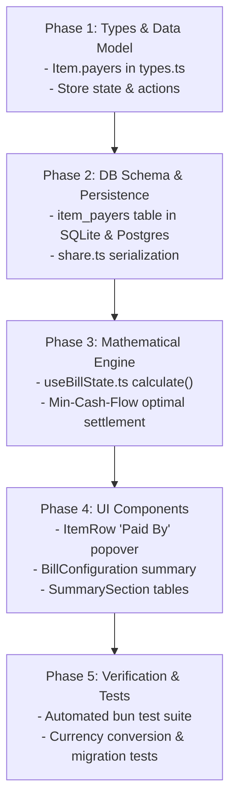

# Architecture & Implementation Plan: Multi-Payer Support (Bill-Level & Item-Level)

> **Document Type**: Technical Specification & Implementation Plan  
> **Status**: Draft for User Review (Planning Mode)  
> **Target Version**: Ledger 2.1  
> **Author**: Antigravity Assistant  
> **Date**: October 2026  

---

## 1. Executive Summary & Problem Statement

Currently, **Ledger** operates primarily on a **Single Primary Payer (Host)** model:
- The `hostId` represents the single individual who settles the receipt with the merchant or venue.
- While individual participants have a `paidAmount` field on the `Person` record, it only accounts for coarse, bill-level upfront transfers (e.g. cash deposits or bank transfers sent to the host).
- **Items have NO concept of who paid for them**. The `Item.assignments` record solely captures *who consumed* (or shared) the item.
- The settlement engine uses a strict **Hub-and-Spoke** topology where all non-host participants either send money to the Host (if debtors) or receive reimbursement from the Host (if creditors).

### The Real-World Need
In modern group activities (team dinners, road trips, group vacations, sports matches, shared rentals), expenses are rarely paid by a single person:
1. **Item-Level Payers**:
   - Alice pays for the expensive bottle of wine ($80).
   - Bob and Charlie split paying for the shared Seafood Platter ($120) 50/50, but 6 people at the table ate it.
   - David grabs the taxi receipt ($35) on the way to the restaurant.
2. **Multiple Payers on a Single Item**:
   - Two people contribute distinct amounts towards a single expensive item or deposit (e.g., Alice puts down $50 and Bob puts down $70 for a $120 activity ticket).
3. **Decoupled Settlement**:
   - When multiple people have paid for various items, multiple creditors emerge simultaneously. A rigid hub-and-spoke model forced through one "Host" creates unnecessary intermediary transactions.

---

## 2. Core Domain Model & Definitions

```
                     ┌───────────────────────────────────┐
                     │               ITEM                │
                     │  - price: 100,000                 │
                     │  - quantity: 1                    │
                     └─────────────────┬─────────────────┘
                                       │
            ┌──────────────────────────┴──────────────────────────┐
            ▼                                                     ▼
┌───────────────────────┐                             ┌───────────────────────┐
│     WHO PAID IT?      │                             │    WHO CONSUMED IT?   │
│     (Payers Map)      │                             │   (Assignments Map)   │
├───────────────────────┤                             ├───────────────────────┤
│ Bob:     60,000 (60%) │                             │ Bob:     1 share      │
│ Charlie: 40,000 (40%) │                             │ David:   1 share      │
│                       │                             │ Eve:     1 share      │
└───────────┬───────────┘                             └───────────┬───────────┘
            │ Credited                                            │ Debited
            ▼                                                     ▼
┌───────────────────────┐                             ┌───────────────────────┐
│  TOTAL PAID BY PERSON │                             │  TOTAL OWED BY PERSON │
└───────────┬───────────┘                             └───────────┬───────────┘
            │                                                     │
            └──────────────────────────┬──────────────────────────┘
                                       ▼
                       ┌───────────────────────────────┐
                       │          NET BALANCE          │
                       │    Balance = Paid - Owed      │
                       │  +ve: Creditor (Reimbursed)   │
                       │  -ve: Debtor   (Must Pay)     │
                       └───────────────┬───────────────┘
                                       ▼
                       ┌───────────────────────────────┐
                       │       SETTLEMENT ENGINE       │
                       │   Min-Cash-Flow / Hub-Spoke   │
                       └───────────────────────────────┘
```

### Definitions:
1. **Consumers (`Item.assignments: Record<PersonId, Quantity>`)**:
   - Represents who enjoyed/consumed the item and in what proportion.
   - Generates the participant's **Cost Liability** (what they owe).
2. **Item Payers (`Item.payers: Record<PersonId, Amount>`)**:
   - Represents who paid the merchant for this specific item and how much.
   - Generates the participant's **Payment Credit** (what they contributed).
3. **Bill-Level Direct Payments (`Person.paidAmount`)**:
   - General upfront cash or transfers not tied to a specific item (e.g., venue deposit, cash given at the table, tips, or unallocated bill contributions).
4. **Default / Fallback Payer**:
   - If an item has no explicit `payers` assigned (`item.payers` is empty or undefined), it automatically falls back to:
     - The **Primary Payer (Host)** if designated, OR
     - The general bill pool (covered proportionally or remaining unpaid).

---

## 3. Data Architecture & Database Migrations

### 3.1 Store & Frontend Types (`src/store/useBillStore.ts`, `db/types.ts`)

```typescript
// db/types.ts & src/store/useBillStore.ts

export interface Item {
  id: string;
  name: string;
  price: number;
  quantity: number;
  assignments: Record<string, number>; // personId -> quantity consumed
  payers?: Record<string, number>;      // personId -> amount paid in current currency
}

export interface ItemData {
  id: string;
  name: string;
  price: number;
  quantity?: number;
  assignments?: Record<string, number>;
  payers?: Record<string, number>;
}
```

### 3.2 Relational Database Schema (`db/sqlite.ts` & `db/postgres.ts`)

To store item-level payer distributions in SQLite and PostgreSQL:

```sql
-- SQLite Table Definition
CREATE TABLE IF NOT EXISTS item_payers (
  item_id TEXT NOT NULL,
  person_id TEXT NOT NULL,
  amount REAL NOT NULL,
  PRIMARY KEY (item_id, person_id),
  FOREIGN KEY(item_id) REFERENCES items(id) ON DELETE CASCADE,
  FOREIGN KEY(person_id) REFERENCES people(id) ON DELETE CASCADE
);

-- PostgreSQL Table Definition
CREATE TABLE IF NOT EXISTS item_payers (
  item_id TEXT NOT NULL,
  person_id TEXT NOT NULL,
  amount DOUBLE PRECISION NOT NULL,
  PRIMARY KEY (item_id, person_id),
  FOREIGN KEY(item_id) REFERENCES items(id) ON DELETE CASCADE,
  FOREIGN KEY(person_id) REFERENCES people(id) ON DELETE CASCADE
);
```

#### Safe Automatic Migration on Startup:
```typescript
// In db/sqlite.ts init() and db/postgres.ts init()
this.db.exec(`
  CREATE TABLE IF NOT EXISTS item_payers (
    item_id TEXT NOT NULL,
    person_id TEXT NOT NULL,
    amount REAL NOT NULL,
    PRIMARY KEY (item_id, person_id),
    FOREIGN KEY(item_id) REFERENCES items(id) ON DELETE CASCADE,
    FOREIGN KEY(person_id) REFERENCES people(id) ON DELETE CASCADE
  );
`);
```

#### Read & Write Logic:
- **`getBill(id)`**:
  Query `item_payers` alongside `item_assignments`:
  ```sql
  SELECT person_id, amount FROM item_payers WHERE item_id = ?
  ```
  Map into `item.payers: Record<string, number>`.
- **`saveBill(id, data)`**:
  Inside the database transaction:
  ```sql
  DELETE FROM item_payers WHERE item_id = ?;
  INSERT INTO item_payers (item_id, person_id, amount) VALUES (?, ?, ?);
  ```

### 3.3 Share URL State Serialization (`src/lib/share.ts`)

To maintain compact URL sharing while supporting item payers:
```typescript
// serializeState:
// i: [id, name, price, quantity, assignments, payers]
i: state.items.map((i: any) => [
  i.id,
  i.name,
  i.price,
  i.quantity,
  i.assignments,
  i.payers || {}
])

// deserializeState:
items: data.i.map((i: any) => ({
  id: i[0],
  name: i[1],
  price: i[2],
  quantity: i[3],
  assignments: i[4],
  payers: i[5] || {} // backwards-compatible if index 5 is missing
}))
```

---

## 4. Mathematical Engine & Settlement Algorithms

### 4.1 Cost Calculation per Participant
The calculation of how much each participant **owes** remains grounded in consumption:
1. **Raw Item Cost**:
   $$\text{RawCost}(p) = \sum_{item} \text{Share}(p, item)$$
   Where unassigned items or leftover portions are split equally among active participants.
2. **Proportional Extras (Taxes, Fees, Discounts)**:
   $$\text{TotalCost}(p) = \text{RawCost}(p) + \text{Extras} \times \frac{\text{RawCost}(p)}{\sum \text{RawCost}}$$
3. **Sponsorship Subsidies**:
   Sponsor surplus is subtracted from debtors via the established proportional discount ratio:
   $$\text{FinalPayable}(p) = \max(0, \text{TotalCost}(p) - \text{Sponsor}(p)) \times (1 - \text{DiscountRatio})$$

### 4.2 Contribution Calculation per Participant
The calculation of how much each participant **paid** is now the sum of their item-level payments and bill-level direct payments:

$$\text{ItemPaid}(p) = \sum_{item} (item.payers[p] \text{ if present else } 0)$$

#### Unallocated Item Costs & Host Fallback:
For each item:
$$\text{AllocatedItemPaid} = \sum_{p} item.payers[p]$$
$$\text{UnallocatedItemCost} = \max(0, item.price - \text{AllocatedItemPaid})$$

- If a **Host** is designated (`hostId` is not null):
  The Host covers all unallocated item costs and all global charges (taxes/fees):
  $$\text{HostAutoCover} = \sum_{items} \text{UnallocatedItemCost} + \text{TotalExtras}$$
- If **No Host** is designated:
  Any gap between $\sum \text{AllocatedItemPaid}$ and $\text{TotalBill}$ is flagged in the Discrepancy Banner.

#### Total Effective Paid Amount:
$$\text{EffectivePaid}(p) = \text{ItemPaid}(p) + p.paidAmount + (\text{HostAutoCover if } p == hostId \text{ else } 0)$$

### 4.3 Net Settlement Balances
Every participant's net balance is:
$$\text{Balance}(p) = \text{EffectivePaid}(p) - \text{FinalPayable}(p)$$

- $\text{Balance}(p) > +0.01 \implies$ **Creditor** (is owed money, paid more than their share).
- $\text{Balance}(p) < -0.01 \implies$ **Debtor** (owes money, paid less than their share).
- $|\text{Balance}(p)| \le 0.01 \implies$ **Settled** (balance is zero).

> **Invariant**: $\sum_{p} \text{Balance}(p) = 0$ (Zero-sum conservation).

### 4.4 Settlement Flow Topology (Dual Mode)

#### Mode 1: Optimal Transfers (Min-Cash-Flow Greedy Bipartite)
*Standard for multi-payer scenarios (e.g. Splitwise).* Minimizes the number of bank transactions across the entire group.
```typescript
function computeOptimalTransfers(balances: Record<string, number>) {
  const debtors = Object.entries(balances)
    .filter(([_, b]) => b < -0.01)
    .map(([id, b]) => ({ id, amount: Math.abs(b) }))
    .sort((a, b) => b.amount - a.amount);

  const creditors = Object.entries(balances)
    .filter(([_, b]) => b > 0.01)
    .map(([id, b]) => ({ id, amount: b }))
    .sort((a, b) => b.amount - a.amount);

  const flows: Array<{ from: string; to: string; amount: number }> = [];

  let d = 0;
  let c = 0;

  while (d < debtors.length && c < creditors.length) {
    const debtor = debtors[d];
    const creditor = creditors[c];
    const settledAmount = Math.min(debtor.amount, creditor.amount);

    if (settledAmount > 0.01) {
      flows.push({ from: debtor.id, to: creditor.id, amount: settledAmount });
    }

    debtor.amount -= settledAmount;
    creditor.amount -= settledAmount;

    if (debtor.amount < 0.01) d++;
    if (creditor.amount < 0.01) c++;
  }

  return flows;
}
```

#### Mode 2: Host-Centered Hub & Spoke (Preserved Option)
If the user prefers routing all reimbursements through the table host (convenient when only the host has everyone's bank details), all debtors pay the host, and the host reimburses other creditors.

---

## 5. UI / UX Design & Component Architecture

### 5.1 Item Row: Dedicated "Paid By" Controls (`src/components/items/item-row.tsx`)

In the item card, next to the existing **"Assign Shares / Splits"** button, introduce a **"Paid By"** button:

```
┌────────────────────────────────────────────────────────────────────────┐
│  Wagyu Ribeye Steak                         ×1   350,000 ₫            │
│  350,000 ₫ PER UNIT  ·  3 members sharing                              │
│                                                                        │
│  [ 👥 3 Splits ]   [ 💳 Paid by: Alex (200k), Bob (150k) ]   [ ⋯ ]    │
└────────────────────────────────────────────────────────────────────────┘
```

#### Inside the "Paid By" Popover:
1. **Quick Single-Payer Selector**:
   - List of all participants. Clicking a participant instantly sets them as 100% payer for this item.
2. **"Split Payment" Mode**:
   - Allows selecting multiple payers for this single item.
   - Presets:
     - **Split Equally**: Automatically divides the item price equally among selected payers.
     - **Custom Amounts**: CurrencyInput fields for each selected payer.
   - **Real-Time Validation Bar**:
     - `Item Total: 350,000 ₫`
     - `Total Paid: 350,000 ₫ · ✓ Fully allocated`
     - Or: `Remaining: 150,000 ₫ · Covered by Host`

### 5.2 Bill Configuration: Payment Overview (`src/components/summary/bill-configuration.tsx`)

- Retain the **"Default Bill Payer (Host)"** selector for general bill settlement and unallocated items.
- Provide a clear **"Payment Breakdown"** table:
  - Participant name
  - Items Paid amount
  - Upfront / Direct amount
  - Total Contribution

### 5.3 Summary Section: Net Balances & Multi-Creditor Settlement (`src/components/summary/summary-section.tsx`)

1. **Splits Table Enhancement**:
   Add a **Paid** column between Sponsor and Final Balance:
   - `Participant | Subtotal | Sponsor | Total Paid | Net Balance`
   - Example:
     - Alex: Subtotal 120k | Paid 350k | Balance: +230k (Receives)
     - Bob: Subtotal 150k | Paid 150k | Balance: 0 (Settled)
     - Charlie: Subtotal 80k | Paid 0 | Balance: -80k (Owes)
2. **Settlement Flows Card**:
   - Distinct creditor and debtor groupings.
   - Shows direct transfers: e.g. **Charlie pays Alex 80,000 ₫**.
   - Copy payment text and individual QR code prompts.

---

## 6. Edge Cases & Safety Constraints

| Scenario | Behavior |
| :--- | :--- |
| **No item payers specified** | Item is automatically attributed to `hostId` (100% backwards compatible with existing bills). |
| **Item partially paid (underpaid)** | If `hostId` exists, host covers the remainder. If no host, discrepancy banner notifies user of unallocated payment. |
| **Item overpaid (sum of payers > price)** | Real-time warning badge in popover; balance calculation honors actual amount paid, crediting payers accordingly. |
| **Person removed from bill** | When `removePerson(id)` is called, remove them from all `item.payers` maps as well as `item.assignments`. |
| **Currency conversion** | When changing bill currency (e.g., VND $\leftrightarrow$ USD), convert all values in `item.payers` alongside item prices and person amounts. |
| **Participant both pays and consumes** | Accurately calculates net offset: if Alice paid $50 and ate $20, she receives $30. |

---

## 7. Phased Implementation Roadmap



### Phase 1: Data Types & Store Actions
- Modify `db/types.ts` and `src/store/useBillStore.ts` to include `Item.payers?: Record<string, number>`.
- Add store actions:
  - `setItemPayers(itemId: string, payers: Record<string, number>): void`
  - Ensure `removePerson` purges the person from `item.payers`.
  - Update `setCurrency` to convert values inside `item.payers`.

### Phase 2: Database Adapters & Sharing
- Create `item_payers` table in `db/sqlite.ts` and `db/postgres.ts`.
- Update `getBill` and `saveBill` methods to fetch and persist item-level payers.
- Update `serializeState` and `deserializeState` in `src/lib/share.ts`.

### Phase 3: Calculation & Settlement Engine
- Update `useBillState.ts`:
  - Calculate total item payments per person.
  - Implement unallocated host coverage fallback.
  - Implement `computeOptimalTransfers` (min-cash-flow greedy algorithm).
  - Add discrepancy detection for unallocated gaps.

### Phase 4: Frontend UI Components
- Update `src/components/items/item-row.tsx`:
  - Create the "Paid By" trigger and popover.
  - Support single-payer select and multi-payer split (equal or custom).
- Update `src/components/summary/bill-configuration.tsx` to display consolidated payments.
- Update `src/components/summary/summary-section.tsx` to display multi-creditor transfers and balances.

### Phase 5: Verification & Automated Tests
- Write automated tests in `tests/multi-payer.test.ts` covering:
  - Single item with multiple payers.
  - Multiple items paid by different people.
  - Partial payments and host auto-cover.
  - Zero-sum settlement balance validation.
  - Currency conversion across item payers.

---

## 8. User Review & Feedback Points

> [!IMPORTANT]
> **Key Design Decisions for User Alignment**:
> 1. **Default Payer Preference**: When an item has no explicit payer, should it default to the **Primary Host** (current behavior) or remain **Unassigned** until explicitly chosen? *(Recommended: Default to Host for smooth, effortless entry).*
> 2. **Settlement Flow Style**: For groups with multiple payers, do you prefer **Direct Optimal Transfers** (minimizes total transactions across everyone, like Splitwise) or a **Host-as-Clearinghouse** mode (all money flows strictly through the host)? *(Recommended: Default to Optimal Transfers with an optional Host-Clearinghouse toggle).*
> 3. **Partial Item Payments**: If an item costs $100 and someone enters that Bob paid $60, should the remaining $40 automatically fall back to the Host? *(Recommended: Yes, automatically covered by Host with a subtle indicator).*
