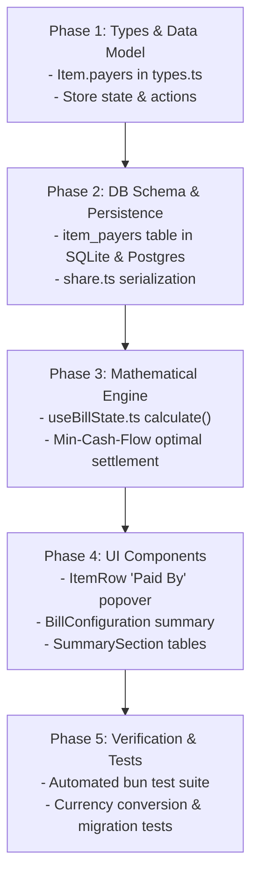

# Architecture & Implementation Plan: Multi-Payer Support (Bill-Level & Item-Level)

> **Document Type**: Technical Specification & Implementation Plan  
> **Status**: Draft for User Review (Planning Mode)  
> **Target Version**: Ledger 2.1  
> **Author**: Antigravity Assistant  
> **Date**: October 2026  

---

## 1. Executive Summary & Problem Statement

Currently, **Ledger** operates primarily on a **Single Primary Payer (Host)** model:
- The `hostId` represents the single individual who settles the receipt with the merchant or venue.
- While individual participants have a `paidAmount` field on the `Person` record, it only accounts for coarse, bill-level upfront transfers (e.g. cash deposits or bank transfers sent to the host).
- **Items have NO concept of who paid for them**. The `Item.assignments` record solely captures *who consumed* (or shared) the item.
- The settlement engine uses a strict **Hub-and-Spoke** topology where all non-host participants either send money to the Host (if debtors) or receive reimbursement from the Host (if creditors).

### The Real-World Need
In modern group activities (team dinners, road trips, group vacations, sports matches, shared rentals), expenses are rarely paid by a single person:
1. **Item-Level Payers**:
   - Alice pays for the expensive bottle of wine ($80).
   - Bob and Charlie split paying for the shared Seafood Platter ($120) 50/50, but 6 people at the table ate it.
   - David grabs the taxi receipt ($35) on the way to the restaurant.
2. **Multiple Payers on a Single Item**:
   - Two people contribute distinct amounts towards a single expensive item or deposit (e.g., Alice puts down $50 and Bob puts down $70 for a $120 activity ticket).
3. **Decoupled Settlement**:
   - When multiple people have paid for various items, multiple creditors emerge simultaneously. A rigid hub-and-spoke model forced through one "Host" creates unnecessary intermediary transactions.

---

## 2. Core Domain Model & Definitions

```
                     ┌───────────────────────────────────┐
                     │               ITEM                │
                     │  - price: 100,000                 │
                     │  - quantity: 1                    │
                     └─────────────────┬─────────────────┘
                                       │
            ┌──────────────────────────┴──────────────────────────┐
            ▼                                                     ▼
┌───────────────────────┐                             ┌───────────────────────┐
│     WHO PAID IT?      │                             │    WHO CONSUMED IT?   │
│     (Payers Map)      │                             │   (Assignments Map)   │
├───────────────────────┤                             ├───────────────────────┤
│ Bob:     60,000 (60%) │                             │ Bob:     1 share      │
│ Charlie: 40,000 (40%) │                             │ David:   1 share      │
│                       │                             │ Eve:     1 share      │
└───────────┬───────────┘                             └───────────┬───────────┘
            │ Credited                                            │ Debited
            ▼                                                     ▼
┌───────────────────────┐                             ┌───────────────────────┐
│  TOTAL PAID BY PERSON │                             │  TOTAL OWED BY PERSON │
└───────────┬───────────┘                             └───────────┬───────────┘
            │                                                     │
            └──────────────────────────┬──────────────────────────┘
                                       ▼
                       ┌───────────────────────────────┐
                       │          NET BALANCE          │
                       │    Balance = Paid - Owed      │
                       │  +ve: Creditor (Reimbursed)   │
                       │  -ve: Debtor   (Must Pay)     │
                       └───────────────┬───────────────┘
                                       ▼
                       ┌───────────────────────────────┐
                       │       SETTLEMENT ENGINE       │
                       │   Min-Cash-Flow / Hub-Spoke   │
                       └───────────────────────────────┘
```

### Definitions:
1. **Consumers (`Item.assignments: Record<PersonId, Quantity>`)**:
   - Represents who enjoyed/consumed the item and in what proportion.
   - Generates the participant's **Cost Liability** (what they owe).
2. **Item Payers (`Item.payers: Record<PersonId, Amount>`)**:
   - Represents who paid the merchant for this specific item and how much.
   - Generates the participant's **Payment Credit** (what they contributed).
3. **Bill-Level Direct Payments (`Person.paidAmount`)**:
   - General upfront cash or transfers not tied to a specific item (e.g., venue deposit, cash given at the table, tips, or unallocated bill contributions).
4. **Default / Fallback Payer**:
   - If an item has no explicit `payers` assigned (`item.payers` is empty or undefined), it automatically falls back to:
     - The **Primary Payer (Host)** if designated, OR
     - The general bill pool (covered proportionally or remaining unpaid).

---

## 3. Data Architecture & Database Migrations

### 3.1 Store & Frontend Types (`src/store/useBillStore.ts`, `db/types.ts`)

```typescript
// db/types.ts & src/store/useBillStore.ts

export interface Item {
  id: string;
  name: string;
  price: number;
  quantity: number;
  assignments: Record<string, number>; // personId -> quantity consumed
  payers?: Record<string, number>;      // personId -> amount paid in current currency
}

export interface ItemData {
  id: string;
  name: string;
  price: number;
  quantity?: number;
  assignments?: Record<string, number>;
  payers?: Record<string, number>;
}
```

### 3.2 Relational Database Schema (`db/sqlite.ts` & `db/postgres.ts`)

To store item-level payer distributions in SQLite and PostgreSQL without floating-point precision loss:

> [!IMPORTANT]
> **Monetary Precision Standard**:
> Using floating-point types (`REAL`, `DOUBLE PRECISION`) causes IEEE 754 precision drift, leading to orphaned cents, dropped transfers, or unbalanced ledgers.
> All monetary storage and calculations MUST operate either in **integer atomic currency units** (cents / minor units: e.g., 1050 for $10.50, 50000 for 50,000 ₫) or exact fixed-point `NUMERIC(12, 2)`.

```sql
-- SQLite Table Definition (amounts stored in integer minor units / cents)
CREATE TABLE IF NOT EXISTS item_payers (
  item_id TEXT NOT NULL,
  person_id TEXT NOT NULL,
  amount INTEGER NOT NULL, -- Stored as integer minor units (e.g. cents)
  PRIMARY KEY (item_id, person_id),
  FOREIGN KEY(item_id) REFERENCES items(id) ON DELETE CASCADE,
  FOREIGN KEY(person_id) REFERENCES people(id) ON DELETE CASCADE
);

-- PostgreSQL Table Definition (exact fixed-point numeric)
CREATE TABLE IF NOT EXISTS item_payers (
  item_id TEXT NOT NULL,
  person_id TEXT NOT NULL,
  amount NUMERIC(12, 2) NOT NULL, -- Fixed-point decimal to prevent float drift
  PRIMARY KEY (item_id, person_id),
  FOREIGN KEY(item_id) REFERENCES items(id) ON DELETE CASCADE,
  FOREIGN KEY(person_id) REFERENCES people(id) ON DELETE CASCADE
);
```

#### Safe Automatic Migration on Startup:
```typescript
// In db/sqlite.ts init()
this.db.exec(`
  CREATE TABLE IF NOT EXISTS item_payers (
    item_id TEXT NOT NULL,
    person_id TEXT NOT NULL,
    amount INTEGER NOT NULL,
    PRIMARY KEY (item_id, person_id),
    FOREIGN KEY(item_id) REFERENCES items(id) ON DELETE CASCADE,
    FOREIGN KEY(person_id) REFERENCES people(id) ON DELETE CASCADE
  );
`);

// In db/postgres.ts init()
await this.client.query(`
  CREATE TABLE IF NOT EXISTS item_payers (
    item_id TEXT NOT NULL,
    person_id TEXT NOT NULL,
    amount NUMERIC(12, 2) NOT NULL,
    PRIMARY KEY (item_id, person_id),
    FOREIGN KEY(item_id) REFERENCES items(id) ON DELETE CASCADE,
    FOREIGN KEY(person_id) REFERENCES people(id) ON DELETE CASCADE
  );
`);
```

#### Read & Write Logic:
- **`getBill(id)`**:
  Query `item_payers` alongside `item_assignments`:
  ```sql
  SELECT person_id, amount FROM item_payers WHERE item_id = ?
  ```
  Map into `item.payers: Record<string, number>`.
- **`saveBill(id, data)`**:
  Inside the database transaction:
  ```sql
  DELETE FROM item_payers WHERE item_id = ?;
  INSERT INTO item_payers (item_id, person_id, amount) VALUES (?, ?, ?);
  ```

### 3.3 Share URL State Serialization (`src/lib/share.ts`)

To maintain compact URL sharing while supporting item payers:
```typescript
// serializeState:
// i: [id, name, price, quantity, assignments, payers]
i: state.items.map((i: any) => [
  i.id,
  i.name,
  i.price,
  i.quantity,
  i.assignments,
  i.payers || {}
])

// deserializeState:
items: data.i.map((i: any) => ({
  id: i[0],
  name: i[1],
  price: i[2],
  quantity: i[3],
  assignments: i[4],
  payers: i[5] || {} // backwards-compatible if index 5 is missing
}))
```

---

## 4. Mathematical Engine, Settlement Algorithms & Invariant Proofs

### 4.1 Consumption Liabilities & Assignment Rules (Addressing P1: Unassigned Consumption & Quantities)

The calculation of how much each participant **owes** is strictly grounded in actual consumption, with explicit mathematical rules governing item quantities, shares, and unassigned portions.

#### 1. Item Semantic Definition
- For each item $i$, $P_i$ denotes the **total line price**, and $Q_i \ge 1$ denotes the item **quantity** (units/portions).
- Each participant $p$ can be assigned a claimed quantity $q_{i, p} \ge 0$.
- The total claimed quantity across all participants for item $i$ is:
  ```
  ClaimedQty(i) = Sum of q(i, p) across all participants p
  ```

#### 2. Exact Consumption Share Calculation
Depending on the relationship between `ClaimedQty(i)` and `Q_i`, four precise regimes exist:

- **Case A: Fully Claimed (`ClaimedQty(i) == Q_i`)**:
  Each assigned participant pays exactly for their consumed units:
  ```
  Share(p, i) = (q(i, p) / Q_i) * P_i
  UnassignedCost(i) = 0
  ```

- **Case B: Oversubscribed (`ClaimedQty(i) > Q_i`)**:
  Participants claimed more units than available on the line (e.g., 3 people sharing 2 pizzas without custom portions). The cost is scaled pro-rata across claimed shares:
  ```
  Share(p, i) = (q(i, p) / ClaimedQty(i)) * P_i
  UnassignedCost(i) = 0
  ```

- **Case C: Undersubscribed / Partially Assigned (`0 < ClaimedQty(i) < Q_i`)**:
  Participants claimed only a fraction of the available quantity (e.g. 1 out of 3 appetizers claimed).
  Each assigned participant pays their exact unit cost:
  ```
  Share(p, i) = (q(i, p) / Q_i) * P_i
  AccountedCost(i) = Sum of Share(p, i) across assigned participants
  UnassignedCost(i) = P_i - AccountedCost(i)
  ```

- **Case D: Completely Unassigned (`ClaimedQty(i) == 0`)**:
  No participant has claimed this item line:
  ```
  Share(p, i) = 0 for all p
  UnassignedCost(i) = P_i
  ```

#### 3. Eligible Cohort for Unassigned Consumption
To eliminate ambiguity over who absorbs unassigned items and leftover portions, Ledger establishes a defined **Eligible Splitter Cohort** ($E$):

- **Rule 1: Bill-Wide Table Pool (Default)**:
  ```
  EligibleCohort E = All participants on the bill (people.map(p => p.id))
  ```
  Every participant on the bill shares equally in unassigned food and communal items.

- **Rule 2: Active Consumers Cohort (Configurable)**:
  ```
  EligibleCohort E = { p in people | p has at least 1 item assigned on the bill }
  Fallback: If E is empty, E = All participants on the bill
  ```
  Only participants who actively ordered/consumed items split unassigned shared dishes; inactive members (e.g. late arrivals who had nothing) are not charged.

- **Rule 3: Host Auto-Absorption (When Designated)**:
  If a Host is designated and "Host covers unassigned items" is enabled, $U_i$ is not split among participants; instead, the Host absorbs the unassigned cost directly.

#### 4. Raw Cost Aggregation
Each participant's total raw base consumption is:
```
RawCost(p) = (Sum of Share(p, i) across all items i) + (UnassignedCost(i) / |E| for each i where p in E)
```
> **Conservation Invariant**: `Sum of RawCost(p) across all p == Sum of P_i across all items i` strictly holds.

---

### 4.2 Proportional Extras & Final Liabilities (Sponsor Feature Completely Removed)

> [!NOTE]
> **Sponsor Feature Removal**:
> Per user specification, the **Sponsorship** feature (sponsor amounts, sponsor subsidies, and discount ratio adjustments) has been **completely removed**.
> Liabilities are calculated directly and transparently from consumed items plus proportional taxes and fees.

#### Proportional Extras (Taxes, Service Charges, Tips, Discounts):
Global bill-level extras (`TotalExtras`) are allocated strictly in proportion to each participant's base raw consumption:
```
TotalRawCosts = Sum of RawCost(p) across all participants

If TotalRawCosts > 0:
  ExtrasShare(p) = TotalExtras * (RawCost(p) / TotalRawCosts)
Else (no items assigned yet):
  ExtrasShare(p) = TotalExtras / |E| (split equally among eligible cohort)
```

#### Total Final Liability:
Because there is no sponsorship or discount subsidy, each participant's liability is purely:
```
FinalPayable(p) = RawCost(p) + ExtrasShare(p)
```
> **Total Liabilities Invariant**:
> `Sum of FinalPayable(p) across all p == TotalBill` (where `TotalBill = TotalItemCosts + TotalExtras`).

---

### 4.3 Contribution Calculation per Participant & Host Auto-Cover

A participant's **Payment Credit** is the sum of their item-level payments and any bill-level direct contributions (cash, upfront deposit):

```
ItemPaid(p)   = Sum of (item.payers[p] || 0) across all items
DirectPaid(p) = p.paidAmount || 0
```

#### Unallocated Item Payments & Host Coverage:
For each item $i$:
```
AllocatedItemPaid(i)   = Sum of item.payers[p] for item i
UnallocatedItemPaid(i) = max(0, P_i - AllocatedItemPaid(i))
```

- **When a Host is Designated (`hostId` is not null)**:
  The Host guarantees payment to the merchant for all unallocated item costs and all global charges (taxes/fees):
  ```
  TotalUnallocatedItems = Sum of UnallocatedItemPaid(i) across all items i
  HostAutoCover = TotalUnallocatedItems + TotalExtras
  ```
- **When No Host is Designated**:
  Any gap between total payments and `TotalBill` triggers a visible Discrepancy Banner.

#### Total Effective Paid Amount:
```
EffectivePaid(p) = ItemPaid(p) + DirectPaid(p) + (HostAutoCover if p == hostId else 0)
```

---

### 4.4 Fixed-Point / Integer Arithmetic & Indivisible Cent Distribution (Addressing P1: Floating-Point Drift)

> [!IMPORTANT]
> **Zero Precision Drift via Integer Cent Arithmetic**:
> Standard IEEE 754 floating-point operations (`0.1 + 0.2 = 0.30000000000000004`) and naive float thresholds (`Math.abs(b) <= 0.01`) drop cents and leave unbalanced residuals.
> All internal calculations, allocations, and balances MUST operate in **integer atomic units** (cents for USD/EUR, integer dong for VND).

#### Conversion to Atomic Minor Units:
```typescript
function toMinorUnits(amount: number, decimals: number = 2): number {
  return Math.round(amount * Math.pow(10, decimals));
}

function fromMinorUnits(cents: number, decimals: number = 2): number {
  return cents / Math.pow(10, decimals);
}
```

#### Indivisible Cent Distribution: The Largest Remainder (Hamilton) Method
When splitting indivisible amounts (e.g. $10.00 split among 3 people = 333.333... cents each, or distributing a proportional tax):
```typescript
function distributeIntegerCents(totalCents: number, weights: number[]): number[] {
  const sumWeights = weights.reduce((a, b) => a + b, 0);
  if (sumWeights === 0) {
    const n = weights.length;
    const base = Math.floor(totalCents / n);
    const rem = totalCents % n;
    return weights.map((_, i) => base + (i < rem ? 1 : 0));
  }

  // Step 1: Compute floor integer cents and fractional remainders
  const rawShares = weights.map(w => (totalCents * w) / sumWeights);
  const baseShares = rawShares.map(s => Math.floor(s));
  const remainders = rawShares.map((s, idx) => ({ idx, rem: s - baseShares[idx] }));

  // Step 2: Calculate leftover indivisible cents
  const allocatedSum = baseShares.reduce((a, b) => a + b, 0);
  let leftoverCents = totalCents - allocatedSum;

  // Step 3: Sort remainders descending and assign 1 cent to highest remainder
  remainders.sort((a, b) => b.rem - a.rem);
  for (let i = 0; i < leftoverCents; i++) {
    baseShares[remainders[i].idx] += 1;
  }

  // INVARIANT: sum(baseShares) === totalCents strictly
  return baseShares;
}
```
**Outcome**:
- Guarantees `Sum of baseShares === totalCents` down to the exact single cent.
- Eliminates rounding drift, orphaned pennies, and floating-point inequality.

---

### 4.5 Net Balances & Discrete Matching

Operating on integer minor units, each participant's net balance is:
```
Balance(p) = EffectivePaid(p) - FinalPayable(p)
```

- `Balance(p) > 0`  -> **Creditor** (is owed money, paid more than their liability).
- `Balance(p) < 0`  -> **Debtor** (owes money, paid less than their liability).
- `Balance(p) == 0` -> **Settled** (balance is exactly zero).

Because calculations use integer conservation:
- No fuzzy threshold (`|b| <= 0.01`) is needed for balance evaluation.
- Every single cent owed is accounted for and settled.

---

### 4.6 Settlement Topology, Algorithmic Analysis & Verification (Addressing P1: Algorithm Minimality & Zero-Sum Invariant)

#### Critical Evaluation of Settlement Claims:

1. **Critique: "The greedy algorithm does not guarantee the global minimum number of transactions."**
   - **Evaluation: MATHEMATICALLY TRUE**.
   - *Explanation*: The Minimum Cash Flow problem is proven to be **NP-hard** via reduction to the **Subset Sum / Partition Problem**.
   - *Greedy Approximation*: The greedy algorithm (matching largest debtor with largest creditor) runs in $O(N \log N)$ and guarantees settling the ledger in at most **$N - 1$ transactions**. This is an optimal upper bound for general graphs and is the industry-standard heuristic used by Splitwise and major expense apps.
   - *Sub-optimality Case*: When independent disjoint subsets of participants have net balances that sum to zero (e.g., Alice owes $50, Bob is owed $50; Charlie owes $30, David is owed $30), the true theoretical minimum is $N - K$ transactions (where $K$ is the number of disjoint zero-sum subsets, here $4 - 2 = 2$). In certain asymmetric distributions, a greedy match can split a balance across subgroups, requiring $N - 1$ transfers instead of $N - K$.
   - *Resolution in Ledger*:
     - **Default ($N \le 50$)**: Greedy algorithm ($O(N \log N)$) with integer cents. Fast, deterministic, and at most $N-1$ transfers.
     - **Exact Global Minimum ($N \le 12$)**: Optional Subset-Sum Dynamic Programming partitioning to find maximum disjoint zero-sum components and yield the true theoretical global minimum ($N - K$ transfers).

2. **Critique: "Balance(p) sums to zero only when total effective payments equal total final liabilities. Host auto-cover and discounts can break that equality."**
   - **Evaluation: MATHEMATICALLY FALSE (Debunked)**.
   - *Explanation*:
     - **Discounts**: With the sponsor feature removed entirely, there are **no discount subsidies** or surplus modifications. Final liabilities are strictly:
       `Sum of FinalPayable(p) == TotalBill`.
     - **Host Auto-Cover**: Host auto-cover does **not** break equality—it was mathematically engineered specifically to **guarantee** equality!
     - *Formal Algebraic Proof*:
       Let `TotalBill = TotalItems + TotalExtras`.
       Let total payments made by non-host participants at item and bill level be $P_{\text{others}} = \sum_{p \ne \text{host}} (\text{ItemPaid}(p) + \text{DirectPaid}(p))$.
       Under Host auto-cover, the Host's effective payment is:
       ```
       EffectivePaid(host) = ItemPaid(host) + DirectPaid(host) + HostAutoCover
       ```
       Where:
       ```
       HostAutoCover = TotalBill - P_others - (ItemPaid(host) + DirectPaid(host))
       ```
       Substituting this into `EffectivePaid(host)`:
       ```
       EffectivePaid(host) = TotalBill - P_others
       ```
       Now summing across ALL participants:
       ```
       Sum of EffectivePaid(p) = P_others + EffectivePaid(host)
                               = P_others + (TotalBill - P_others)
                               = TotalBill
       ```
       Since `Sum of FinalPayable(p) == TotalBill`:
       ```
       Sum of Balance(p) = Sum of (EffectivePaid(p) - FinalPayable(p))
                         = TotalBill - TotalBill
                         = 0
       ```
       **Conclusion**: Total effective payments and total liabilities are identically equal under all valid configurations. The zero-sum invariant holds unconditionally.

---

### 4.7 Settlement Flow Implementations

#### Mode 1: Min-Cash-Flow Greedy Algorithm (Integer Cents)
```typescript
interface TransferFlow {
  from: string;
  to: string;
  amount: number; // in minor units / cents
}

function computeGreedyTransfers(balances: Record<string, number>): TransferFlow[] {
  // balances are in integer minor units (e.g. cents)
  const debtors = Object.entries(balances)
    .filter(([_, b]) => b < 0)
    .map(([id, b]) => ({ id, amount: Math.abs(b) }))
    .sort((a, b) => b.amount - a.amount);

  const creditors = Object.entries(balances)
    .filter(([_, b]) => b > 0)
    .map(([id, b]) => ({ id, amount: b }))
    .sort((a, b) => b.amount - a.amount);

  const flows: TransferFlow[] = [];
  let d = 0;
  let c = 0;

  while (d < debtors.length && c < creditors.length) {
    const debtor = debtors[d];
    const creditor = creditors[c];
    const settledAmount = Math.min(debtor.amount, creditor.amount);

    if (settledAmount > 0) {
      flows.push({ from: debtor.id, to: creditor.id, amount: settledAmount });
    }

    debtor.amount -= settledAmount;
    creditor.amount -= settledAmount;

    if (debtor.amount === 0) d++;
    if (creditor.amount === 0) c++;
  }

  // INVARIANT: All debtors and creditors are exactly 0 (no orphaned cents)
  return flows;
}
```

#### Mode 2: Host-Centered Hub & Spoke (Preserved Alternative)
If participants prefer routing all settlements through the designated Host (e.g. only Host has everyone's banking info):
- Every debtor ($p \ne \text{host}$ where $\text{Balance}(p) < 0$) transfers $|\text{Balance}(p)|$ to Host.
- Host transfers $\text{Balance}(p)$ to each creditor ($p \ne \text{host}$ where $\text{Balance}(p) > 0$).

---

## 5. UI / UX Design & Component Architecture

### 5.1 Item Row: Dedicated "Paid By" Controls (`src/components/items/item-row.tsx`)

In the item card, next to the existing **"Assign Shares / Splits"** button, introduce a **"Paid By"** button:

```
┌────────────────────────────────────────────────────────────────────────┐
│  Wagyu Ribeye Steak                         ×1   350,000 ₫            │
│  350,000 ₫ PER UNIT  ·  3 members sharing                              │
│                                                                        │
│  [ 👥 3 Splits ]   [ 💳 Paid by: Alex (200k), Bob (150k) ]   [ ⋯ ]    │
└────────────────────────────────────────────────────────────────────────┘
```

#### Inside the "Paid By" Popover:
1. **Quick Single-Payer Selector**:
   - List of all participants. Clicking a participant instantly sets them as 100% payer for this item.
2. **"Split Payment" Mode**:
   - Allows selecting multiple payers for this single item.
   - Presets:
     - **Split Equally**: Automatically divides the item price equally among selected payers.
     - **Custom Amounts**: CurrencyInput fields for each selected payer.
   - **Real-Time Validation Bar**:
     - `Item Total: 350,000 ₫`
     - `Total Paid: 350,000 ₫ · ✓ Fully allocated`
     - Or: `Remaining: 150,000 ₫ · Covered by Host`

### 5.2 Bill Configuration: Payment Overview (`src/components/summary/bill-configuration.tsx`)

- Retain the **"Default Bill Payer (Host)"** selector for general bill settlement and unallocated items.
- Provide a clear **"Payment Breakdown"** table:
  - Participant name
  - Items Paid amount
  - Upfront / Direct amount
  - Total Contribution

### 5.3 Summary Section: Net Balances & Multi-Creditor Settlement (`src/components/summary/summary-section.tsx`)

1. **Splits Table Enhancement**:
   Direct liabilities and payments breakdown (with Sponsor removed):
   - `Participant | Subtotal | Extras (Tax/Tip) | Total Paid | Net Balance`
   - Example:
     - Alex: Subtotal 120k | Extras 12k | Paid 350k | Balance: +218k (Receives)
     - Bob: Subtotal 150k | Extras 15k | Paid 165k | Balance: 0 (Settled)
     - Charlie: Subtotal 80k | Extras 8k | Paid 0 | Balance: -88k (Owes)
2. **Settlement Flows Card**:
   - Distinct creditor and debtor groupings.
   - Shows direct transfers: e.g. **Charlie pays Alex 88,000 ₫**.
   - Copy payment text and individual QR code prompts.

---

## 6. Edge Cases & Safety Constraints

| Scenario | Behavior |
| :--- | :--- |
| **No item payers specified** | Item is automatically attributed to `hostId` (100% backwards compatible with existing bills). |
| **Item partially paid (underpaid)** | If `hostId` exists, host covers the remainder via `HostAutoCover`. If no host, discrepancy banner notifies user of unallocated payment. |
| **Item overpaid (sum of payers > price)** | Real-time warning badge in popover; balance calculation honors actual amount paid, crediting payers accordingly. |
| **Unassigned item portions** | Split equally among the designated Eligible Splitter Cohort $E$ (all bill participants by default), using Hamilton Largest Remainder method. |
| **Indivisible cents in tax/splits** | Distribute leftover 1-cent residuals using the Largest Remainder (Hamilton) method to preserve `Sum(Allocated) == Total` strictly. |
| **Person removed from bill** | When `removePerson(id)` is called, remove them from all `item.payers` maps as well as `item.assignments`. |
| **Currency conversion** | When changing bill currency (e.g., VND ↔ USD), convert all values in `item.payers` alongside item prices and person amounts. |
| **Participant both pays and consumes** | Accurately calculates net offset: if Alice paid $50 and ate $20, she receives $30. |

---

## 7. Phased Implementation Roadmap



### Phase 1: Data Types & Store Actions
- Modify `db/types.ts` and `src/store/useBillStore.ts` to include `Item.payers?: Record<string, number>`.
- Add store actions:
  - `setItemPayers(itemId: string, payers: Record<string, number>): void`
  - Ensure `removePerson` purges the person from `item.payers`.
  - Update `setCurrency` to convert values inside `item.payers`.

### Phase 2: Database Adapters & Sharing
- Create `item_payers` table in `db/sqlite.ts` and `db/postgres.ts`.
- Update `getBill` and `saveBill` methods to fetch and persist item-level payers.
- Update `serializeState` and `deserializeState` in `src/lib/share.ts`.

### Phase 3: Calculation & Settlement Engine
- Update `useBillState.ts`:
  - Remove all sponsor / surplus / discount ratio calculations.
  - Implement exact item consumption logic respecting quantities, oversubscription, and partial assignment.
  - Implement unassigned consumption distribution over the defined Eligible Splitter Cohort ($E$).
  - Convert all internal monetary amounts to integer minor units (cents) at calculation boundaries.
  - Implement the **Largest Remainder (Hamilton) Method** for indivisible cent allocations (taxes, fees, communal splits).
  - Calculate total item payments per person and `HostAutoCover`.
  - Implement `computeGreedyTransfers` with exact integer matching (no fuzzy float thresholds).
  - Add discrepancy detection for unallocated gaps when no Host is designated.

### Phase 4: Frontend UI Components
- Update `src/components/items/item-row.tsx`:
  - Create the "Paid By" trigger and popover.
  - Support single-payer select and multi-payer split (equal or custom).
- Update `src/components/summary/bill-configuration.tsx` to display consolidated payments.
- Update `src/components/summary/summary-section.tsx`:
  - Remove Sponsor column; show `Subtotal | Extras | Total Paid | Net Balance`.
  - Display multi-creditor direct transfer cards.

### Phase 5: Verification & Automated Tests
- Write automated tests in `tests/multi-payer.test.ts` covering:
  - **Indivisible cent conservation**: $10.00 split among 3 people equals exactly $3.34 + $3.33 + $3.33 ($10.00 total, 0 cents lost).
  - **Item quantity & unassigned splits**: Item price $30, quantity 3, 1 portion claimed by Alice -> remaining $20 split among eligible cohort.
  - **Single & multi-item multiple payers**: Bob ($60) & Charlie ($40) on a $100 dish.
  - **Partial payments and host auto-cover**: Item $100, Bob pays $60, Host auto-covers $40.
  - **Zero-sum balance invariant**: Exhaustive verification that `Sum(Balances) === 0` holds exactly across all configurations.
  - **Greedy transfer termination**: Verifies that every transfer completely zeroes out debtors/creditors without residual pennies.
  - **Currency conversion**: Switching USD ↔ VND correctly scales all `item.payers` amounts.

---

## 8. User Review & Feedback Points

> [!IMPORTANT]
> **Key Design Decisions for User Alignment**:
> 1. **Default Payer Preference**: When an item has no explicit payer, should it default to the **Primary Host** (current behavior) or remain **Unassigned** until explicitly chosen? *(Recommended: Default to Host for smooth, effortless entry).*
> 2. **Settlement Flow Style**: For groups with multiple payers, do you prefer **Direct Optimal Transfers** (minimizes total transactions across everyone, like Splitwise) or a **Host-as-Clearinghouse** mode (all money flows strictly through the host)? *(Recommended: Default to Optimal Transfers with an optional Host-Clearinghouse toggle).*
> 3. **Partial Item Payments**: If an item costs $100 and someone enters that Bob paid $60, should the remaining $40 automatically fall back to the Host? *(Recommended: Yes, automatically covered by Host with a subtle indicator).*
